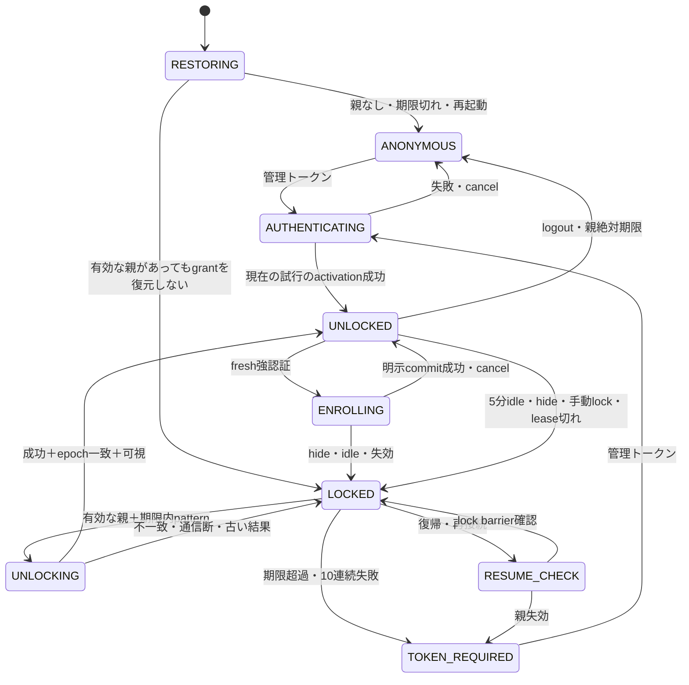

# SuiBa 自動ロック・パターン再認証：現状調査・詳細設計

調査日：2026-10-27（JST）。区分：**調査・設計のみ。実装承認を意味しない。**

公開時注記：ユーザーの追加指示「mainにpush」に基づき、この設計書のみをmainへ追加する。追加作業の基点は `a6db35752202260d687d6a5876f27dcb8e82c018`。本文の「最新main」、行番号、現状評価、および「commit/pushを行っていない」という記述は、調査終了時点の `e90840d916166c58cc040d48e72f2aa606bd557f` に関する記録であり、公開時点の再調査結果ではない。アプリケーション実装・設定変更・Bot操作は本公開にも含めない。

## 結論と適用条件

推奨は **BをAのHttpOnly Cookieで実現する「サーバー側の親セッション＋短命なタブ別管理操作許可＋パターン再認証」**。単一worker・DB追加なしを前提に、親セッションと操作許可はメモリ、パターン検証情報と失敗制限は専用ファイルに保存する。人間のブラウザと自動検証の資格情報・認可経路を分離する。WebAuthnは将来の強化候補とし、今回の必須依存にしない。

安全に導入できるが、現在の7日署名Cookieへパターン画面を足すだけでは不十分。失効可能なサーバー側状態、CSRF・認可の統一、競合防止、自動検証権限を先に整備する。既存バックテストPOSTの認証不整合も先に修正する必要がある。

**保証の境界**：ブラウザがイベントを実行せず、通信も届かない瞬間のバックグラウンド移行をサーバーが検知することはできない。正常時は即時通知でロック、通知不能時は既存の操作許可が最大15秒残る設計とする。復帰時はその残存時間にかかわらずパターンまたは管理トークンを要求する。この15秒も許容できない場合、通常のWebアプリでは「完全なサーバー即時検知」を満たせないため要件調整が必要。

## A. 現状調査レポート

### A1. 対象と確認範囲

| 項目 | 確認結果 |
|---|---|
| リモート最新main | `e90840d916166c58cc040d48e72f2aa606bd557f`。`git ls-remote origin refs/heads/main`で確認 |
| コミット | `fix(auth): preserve browser login with persistent signed sessions`、2026-10-27 12:53:22 +09:00 |
| 読み取ったHEAD | 上記SHAと一致。現在のブランチ名は `fix/e2e-auth-fixtures-and-narration` |
| ローカルmain参照 | `be8b202a006bd5a59236f5685155af47264bcfa6`。古いため調査基準にしない |
| 作業ツリー | 追跡ファイルの差分なし。既存の未追跡Nodeインストールログ2件は触れていない |
| 稼働コンテナ | `suiba-deepbook-24h-bot-1`、観測時Up約11時間、healthy。healthyは取引running=trueの証明ではない |
| コンテナのソース | 最新mainと一致しない。worker `index.ts` のSHA256が異なり、`browser-session.ts` は存在しない |
| コンテナのビルド識別 | OCI revisionラベルは `unknown`。完全な稼働ソースSHAは未確定 |
| 実施した操作 | Git・ソース・限定メタデータの読み取り、コンテナ内の別Nodeプロセスでversion/API存在/公開ソースhash確認、公式仕様参照 |
| 実施していない操作 | ログイン・ログアウト・認証API操作、Bot制御、再起動、テスト、ビルド、依存追加、設定変更、commit/push/PR/merge |

調査対象は[固定mainコミット](https://github.com/tajumaru/SuiBa/tree/e90840d916166c58cc040d48e72f2aa606bd557f/sui-ai-trading-bot)。以下のソース行番号はすべてこのSHA。稼働イメージへ最新認証が反映済みとは判断しない。秘密ファイル、`.env` の値、Cookie、Authorization実値、実セッションは取得・出力していない。

### A2. Node.js：設定と実ランタイム

| 層 | 設定／実測 |
|---|---|
| package.json:5–7 | `>=24.22.1 <25`。単に24.22.1以上というだけでなく、25以上も現在は非対応 |
| .nvmrc / .node-version:1 | ともに `24.22.1` |
| docker/Dockerfile:1 | `node:24.22.1-bookworm-slim`、digest固定 |
| scripts/verify-node-version.mjs:4–36 | 実行中のprocess.versionを検証。24系かつ24.22.1以上のみ許可 |
| scripts/run-project.mjs:72–81 | 子ツールもprocess.execPathで起動し、そのディレクトリをPATH先頭にする |
| worker index.ts:1 | 起動時のバージョン制約をimport |
| .github/workflows/suiba-offline.yml:13,20–29 | Windows/Ubuntu、Node 24.22.1、typecheck/build/test:offline |
| Windowsの今回のシェル | `node --version` → **v24.22.1** |
| 稼働コンテナ内のNode実行物 | `process.version` → **v24.22.1**、OpenSSL **3.5.9**、`typeof crypto.argon2` → **function** |

コンテナ内の値は同じコンテナの別プロセスでの実測であり、Botプロセス内に診断コードを注入した結果ではない。PID 1はdocker-init。今回は稼働Bot自身のprocess.versionログや実行ファイル差し替え履歴までは検証していない。設定値だけでバージョン対応済みと判断してはいない。

### A3. 現在の認証フローと関連ソース

以下のリンクはローカルで確認した対象ファイル。関数・範囲は右列に示す。

| 項目 | ファイル・関数・行番号と処理 |
|---|---|
| 管理トークン設定 | [worker/index.ts](D:/Source/SuiBa/sui-ai-trading-bot/apps/worker/src/index.ts:44) 44–49：ADMIN_TOKEN_FILE優先、readFileSync→trim。なければADMIN_TOKEN。32文字未満は起動拒否 |
| Bearer検証 | [browser-session.ts](D:/Source/SuiBa/sui-ai-trading-bot/apps/worker/src/browser-session.ts:39) `bearer` 39–40、`equal` 6–9：長さ一致後timingSafeEqual。全管理権限を持つ単一共有秘密 |
| Cookie生成 | 同ファイル `issue` 19–21：期限＋24byte乱数＋管理トークンを鍵とするHMAC-SHA256。トークン自体はCookieに含めない |
| Cookie検証 | 同 `valid` 23–37：署名・期限を検証。セッションレコード・失効表・ロック状態なし |
| Cookie属性 | 同 `setCookie` 42–49：`suiba.session; Path=/api; HttpOnly; SameSite=Strict; Max-Age=604800`。TLS socketまたはX-Forwarded-Proto=httpsならSecure |
| API認証ゲート | [worker/index.ts](D:/Source/SuiBa/sui-ai-trading-bot/apps/worker/src/index.ts:270) 270–279：全`/api/`にBearer **または**Cookie。非GETのCookie要求は追加ガード |
| CSRFガード | browser-session.ts `sessionMutationAllowed` 55–60：X-SuiBa-Request=1、Sec-Fetch-Siteはsame-originまたは欠如。CORS許可なし。Origin完全一致やCSRF nonceは未実装 |
| セッションAPI | worker/index.ts 280–290：GET確認、POST新Cookie、DELETE Cookie削除。POSTは既存Cookieだけでも可能 |
| ログインprobe | [verifyToken.ts](D:/Source/SuiBa/sui-ai-trading-bot/apps/dashboard/src/verifyToken.ts:43) `verifyToken` 43–107：Bearerでsummary、404のみstate fallback。8秒全体期限、JSON構造検査、redirect:error、401/TIMEOUT/NETWORK等の区別 |
| Cookieへの交換 | [browserSession.ts](D:/Source/SuiBa/sui-ai-trading-bot/apps/dashboard/src/browserSession.ts:5) `loginSession` 5–23：probe成功後POST auth/session。現状はresponse.okで成功とする |
| フロント状態 | [main.tsx](D:/Source/SuiBa/sui-ai-trading-bot/apps/dashboard/src/main.tsx:219) 219–241,459–462：React token状態へ実管理トークンではなくSESSIONというマーカーを設定 |
| 再読み込み復元 | main.tsx 220–239：GET auth/session、authenticated=trueで復元。8秒期限、AbortSignal.any/timeout使用 |
| ログアウト | main.tsx `logout` 267–280：DELETE成功または401後、token/data消去。通信失敗時は元画面を保持 |
| 共通API | main.tsx 319–345：SESSION時Bearerを付けずCookie、X-SuiBa-Requestを付与。401でtoken/data消去 |
| ログイン競合対策 | [LoginScreen.tsx](D:/Source/SuiBa/sui-ai-trading-bot/apps/dashboard/src/LoginScreen.tsx:64) 64–110、[loginAttempt.ts](D:/Source/SuiBa/sui-ai-trading-bot/apps/dashboard/src/loginAttempt.ts:6) 6–40：同期single-flight、世代番号、abort、unmount/cancel、成功通知1回 |
| トークンの一時保持 | LoginScreen.tsx 24,69–85：入力状態・非同期クロージャに一時保持し、送信時入力欄を消去。GCタイミングまで厳密なゼロ化は保証しない |
| localStorage | [patternLock.ts](D:/Source/SuiBa/sui-ai-trading-bot/apps/dashboard/src/patternLock.ts:15) `removeLegacyPatternLock` 15–40：旧3キーの削除だけ。復号・再保存なし。LoginScreen 32–42で実行 |
| sessionStorage | 対象アプリソースの検索で認証用途の使用なし |
| document.cookie | フロントで直接読み書きなし。HttpOnly Cookieをサーバーが発行 |
| 複数タブ | Cookieを共有するがReact状態は各タブ。BroadcastChannel/storageによる認証同期なし。別タブログアウト後は次回APIの401で追従 |
| ポーリング | main.tsx 383–393：10秒。 [OperationsPanel.tsx](D:/Source/SuiBa/sui-ai-trading-bot/apps/dashboard/src/OperationsPanel.tsx:669) `useOperationsFeed` 669–722：operations/stateを10秒周期、世代ガードあり |
| WebSocket / SSE | 対象dashboard/workerソースにWebSocket/EventSourceによる管理配信の実装は見つからない。現行はHTTPポーリング。将来導入時は接続・各送信・再接続で認可が必要 |
| バックグラウンドイベント | AgentNarration.tsx:375–381、OperationOverview.tsx:93–100に時刻表示更新用visibilitychange/pageshow。認証ロック処理ではない |
| 独自fetch | [BacktestComparison.tsx](D:/Source/SuiBa/sui-ai-trading-bot/apps/dashboard/src/BacktestComparison.tsx:165) 165–176：渡されたSESSIONマーカーもBearerとして送る。X-SuiBa-Requestなし |
| 応答保護 | worker/index.ts 190–195：no-store、nosniff、CSP script-src self / frame-ancestors none。535–536は汎用REQUEST_FAILEDへ抑制 |
| Bot分離の根拠 | worker/index.ts 128–141 watchdog、161–187 scheduler/engine.tick、543–547 scheduler.start。API controlは476–532。ブラウザ接続をBot周期の開始条件にしていない |

現行の絶対期限は発行から7日だが、CookieによるPOST auth/sessionで新しい7日Cookieを作れるため、強い再認証からの絶対上限にはなっていない。DELETEはそのブラウザのCookie削除のみで、コピー済みCookieをサーバー側で失効しない。同じ管理トークンを維持する限り署名Cookieはサーバー再起動後も有効。管理トークン変更時は署名が変わり全Cookieが失効するが、プロセスへの反映方法・停止影響は別の運用作業になる。

### A4. 既存セキュリティ指摘の状況

| 項目 | 判定と残る問題 |
|---|---|
| パターン由来鍵で管理トークンを暗号化しlocalStorageへ保存 | **最新mainでは撤去済み**。履歴a804f4cの方式をb5bc366で廃止。現行patternLock.tsは削除専用 |
| 旧保存データの処理 | 3キー削除、読取拒否でも削除試行、失敗表示あり。削除はLoginScreen mount時のため、Cookie復元だけで画面に入る場合は直ちに実行されない。コピー済みデータ・別タブ・別端末・バックアップは消せない |
| トークンの平文ブラウザ永続化 | 現行アプリでは新規保存なし。ただし過去に盗まれた暗号文の危険が消えた証明にはならない。心当たり時のローテーションが必要。今回は実行しない |
| UI多重ログイン・古い結果 | single-flight/世代ガードは実装済み。ただしabortしても届いたPOSTのSet-Cookieが無効になる保証はない。サーバーの認証状態とUIキャンセルの整合を追加設計する |
| 個別セッション失効・自動ロック | **未実装**。現行Cookieは署名だけのため、サーバーロックを表せない |
| スライド更新による期限延長 | 強認証時刻の保存なし。7日の再発行を禁止する設計が必要 |
| Cookie Secure | プロキシヘッダーを直接信頼し、HTTPではSecureを省略。信頼するプロキシ境界・本番HTTPS強制を明示する必要 |
| CSRF | カスタムヘッダー＋Fetch Metadata＋SameSiteで一定の対策済み。完全一致Origin/Host検証・専用nonce・セッションAPIまで統一した検証へ強化する |
| レート制限・監査 | 認証専用の失敗回数、ロックアウト、失効監査が当該認証経路にない |
| バックテスト回帰 | SESSION文字列は正規Bearerではない。CookieがあればGETは通るが、POSTは追加ヘッダー欠如により403となるコード経路。**ソースからの判定で、実環境で再現操作していない** |
| XSS | CSP等の防御あり。HttpOnlyでも同一originの悪意あるJSによる操作は防げない。パターンはXSS対策の代替ではない |

「既知指摘はすべて修正済み」とは断定しない。確認できたのは上記のソース・履歴と対応関係であり、全Issue/PRや外部監査の網羅照合は行っていない。稼働コンテナは別版なので、ここでの修正済み判定は最新mainに限る。

### A5. 自動検証・Docker・DB方針

| 経路 | 現状／影響 |
|---|---|
| CLI・unattended | docker/deepbook-24h.mjs:121–141はコンテナ内でADMIN_TOKEN_FILEを読み、Bearerでvalidation/startやvalidation/reportを呼ぶ。人間のブラウザCookieとは独立 |
| 30分 | compose.preflight-30m.yaml:2–18,32–57。専用project/image/SHA/secret/volume、read_only＋tmpfs。新しい検証を今回は起動していない |
| 2時間 | docs/PAPER_RUN2_PREFLIGHT_REPORT.md:1–7,144に既存記録。停止状態での通信観測という条件がある。認証設計を理由にstart/resetを自動実行しない |
| 24時間 | compose.deepbook-24h.yaml:12–25、deepbook-24h.mjs:124。起動済みの検証はそのまま維持する必要がある |
| Docker内API | localhost:3100へのBearer。ホスト公開は基本127.0.0.1。Docker内だから無認証でよいという実装ではない |
| APIテスト | tests/settings-api.test.ts:59,87、verify-runtime.ts:18,40等はテスト用トークンで隔離workerを操作 |
| Cookieテスト | tests/browser-session.test.ts:12–62、browser-session-login.test.ts。永続署名Cookieの再起動有効性は現行仕様としてテストに存在 |
| ブラウザテスト | playwright.auth.config.ts:5–24はChromium＋iPhone 13相当WebKit。tests/e2e/login.pw.ts:203以降にはAPIモック。モック成功は本物のCookie・サーバー認可の証明ではない |
| CI | .github/workflows/suiba-offline.yml:19–29はNode固定・offline検証。実運用の秘密を必要としない構成を維持 |
| トークンのサーバー保存 | 基本composeはenv_file、専用検証composeはDocker secretファイル。値は今回未読。環境変数方式は権限あるinspect等による露出面がある |
| DB不使用という条件 | **現コードはすでにSQLite使用**。packages/database/src/index.ts:2,182–184のnode:sqlite/DatabaseSync、worker:57のBotDatabaseが根拠。「新たな認証DB／外部DBを増やさない」と解釈して提案する |

## B. 推奨アーキテクチャ

### B1. 信頼境界とデータモデル

ブラウザ → 信頼済みHTTPS終端 → worker認証・認可ゲート → 管理API、という経路に統一する。Bot scheduler/engine/market transport/risk/profit/ledger/healthはブラウザ認証から独立させる。

| 要素 | 内容・保存先 |
|---|---|
| 親セッション | 256bit乱数SID。ブラウザにはHttpOnly Cookieのみ。サーバーはSIDのSHA256をキーとし、principal=admin、strongAuthenticatedAt、absoluteExpiresAt、patternEligibleUntil、authEpoch、csrf nonce、revokedをメモリ保持 |
| タブ別操作許可 | 256bit乱数grantをタブのメモリだけに保持し専用ヘッダーで送信。サーバー側にはhash、親SID、tabId、familyEpoch、idleDeadline、leaseExpiresAt、許可scope。Cookieだけでは機密APIへ入れない |
| ロック単位 | 同じ親Cookieを共有する全タブを1familyとし、どれかのロックで全タブのgrantを失効する。別端末の独立セッションまで毎回ロックしない。管理トークン／パターン変更時は全family失効 |
| パターン検証情報 | 現在の単一adminモデルでは**システムに1個**。version、policyVersion、salt、Argon2idパラメータ、hash、pepper key id、credentialVersionを専用永続ファイルへ。将来複数admin化ではprincipal別へ拡張 |
| 失敗制限情報 | credentialVersionごとの失敗数、blockedUntil、strongRequiredを同じ専用ストアで永続化。セッションを替えても回数をリセットしない |
| Pepper | 管理トークンとは独立した256bit秘密。Docker secretで読取専用供給。検証情報と同じvolume/バックアップへ入れない |
| 監査 | eventId、時刻、匿名化session参照、action、scope、結果、理由、credentialVersion、runId。token/pattern/hash/Cookie/生IPや本文をログに出さない |

セッションをメモリだけにするため、worker/Docker再起動時は管理トークンでログインし直す。パターン自体は残すが、それだけで新しい親セッションを作れない。現行の「再起動後も7日Cookie復元」からの意図的な変更であり、受け入れ確認が必要。認証の永続セッションまで必須ならSQLite等のトランザクションストアが必要になり、本案より実装負担が増す。

### B2. 推奨期限

| 期限 | 推奨値 | 根拠／更新条件 |
|---|---|---|
| 無操作ロック | 300秒 | 設定キーidleLockSeconds、初期300。将来60–900秒程度の範囲で設定可能。変更は管理トークンによるfresh再認証、延長しても既存のロックは解除しない |
| バックグラウンド | 検出時直ちにlocal lock＋サーバーlock送信 | 通信不能時のサーバー側残存許可は下記leaseで制限 |
| 管理操作lease | 15秒、可視の前景で5秒ごとにpresence更新 | presenceは無操作期限を更新しない。遅延更新は期限切れgrantを復活させない |
| 親セッション絶対期限 | 強認証から12時間 | 8時間は厳格、24時間は便利だが盗難時の期間が長い。12時間を推奨。パターン・presenceでは延長しない |
| パターン許可期限 | 強認証から8時間、かつ最後のlockから30分以内 | 8時間経過、または30分超の離席は管理トークン。繰り返しunlockしても強認証時刻は更新しない |
| fresh強認証 | 5分以内 | pattern登録・置換・削除、機密な認証設定、自動化権限発行。入力tokenは確認後破棄 |
| 自動化access token | 10分 | 下記の期限付きrun許可から更新。人間のidle/visibilityルールは適用しない |
| 自動化run許可 | 最大26時間、runごとに明示設定 | 30分/2時間/24時間＋後処理の必要時間に限定。scope変更不可、任意延長不可 |

サーバーは受信時刻で期限を計算し、クライアント申告時刻で延長しない。単調時計でプロセス内のidle/leaseを管理し、絶対期限の時計巻戻りでも元の許可時間を超えないよう発行時の単調時計上限を併用する。再起動で全親セッションを破棄する。persisted lockoutは時計異常・読取失敗時にfail closedとする。

### B3. フロー

**初回ログイン**

1. 起動・reload・pageshowでは機密ビューを描画せずRESTORINGへ。旧localStorageキーの削除専用migrationはログイン画面だけでなく起動時にも実行する設計とする。
2. 管理トークンをHTTPSのPOST loginへ送信し、サーバーが検証・レート制限する。現在の機密summaryをprobeとして読む必要はなくす。
3. 検証成功で旧SIDを失効し、新SIDを発行。ログイン応答は親セッション作成に限り、キャンセル後のSet-Cookieで自動的にUNLOCKEDにならないようにする。
4. 画面がまだ可視で、その認証試行がcurrentである場合のみ、一回限りの短命activation challengeを確認してタブgrantを取得。キャンセルやhide後の古いactivationは拒否。
5. パターン未登録なら任意登録へ案内。未登録でも管理トークンで通常利用可。登録しない利用者も5分lockは有効で、解除には管理トークンを使う。

**パターン登録**

1. UNLOCKEDかつfresh強認証で、期限2分のenrollment challengeを開始。既存pattern変更には再度tokenを求める。
2. 1回目と確認入力はメモリだけで保持。両方をTLS POSTで送り、サーバーでもcanonical化・一致・policyを検証。ログ／URLへ含めない。
3. 並列KDF数を制限してhash作成。完了後にsession/epoch/challenge期限を再検証し、commitを原子的に行う。ページ離脱で自動保存しない。明示commit前のdraftに有効性はない。
4. 登録成功後は両入力・線を消去。変更時はcredentialVersionを更新し、既存pattern由来grantと他familyを失効。現在のfresh強認証familyも新SIDへローテーションする。
5. cancelとcommitが競合した場合、サーバーが先にcommitを確定した事実はabortだけでは戻らない。状態照会で確定結果を表示し、必要ならfresh tokenで削除する。「キャンセルすれば保存済み変更まで必ず消える」とは約束しない。

**ユーザー操作・5分ロック**

- pointerdown、click、keydown、wheel、touch操作に由来するscrollを対象。Event.isTrusted、前景、UNLOCKEDを確認する。scrollはブラウザ生成のプログラムスクロールでもtrustedになり得るため、それ単独を根拠にせず、直近のtrusted wheel/touch/pointer/keyboard操作との関連を確認する。
- pointermove/mousemove単独は除外。パターン描画中のmoveは入力処理にだけ使用し、ロック中のidle更新には使わない。dispatchEvent等の合成イベントは除外。isTrustedはXSSやブラウザ自動操作に対するセキュリティ境界ではない。
- 最初の操作は即時activity通知、連続操作は最大1秒程度で集約。通知が間に合わず期限切れなら安全側にlock。API polling・presence・市場更新・SSE・WebSocket・Bot処理はactivityを呼べないAPI構造にする。
- サーバーはactivity専用POSTだけでidleDeadlineを更新。**期限経過後のactivityでは解除しない**。各管理API受信時にもidle/lease/epochを確認する。クライアントtimerは表示のための補助であり、API側判定の代替にしない。
- local deadlineまたはサーバーlockで機密ビューをunmount、全機密store/cache/チャート/ナレーションの蓄積を消去、APIをabort、generation増加、grantを破棄。Bot制御APIは呼ばない。

**バックグラウンド・復帰**

- visibilitychange(hidden)とpagehideは冪等なlocal lockを実行し、fetch keepaliveでlock通知。通常のカスタムCSRFヘッダーを使う。sendBeaconはカスタムヘッダーが使えないので単純な認証例外APIを追加しない。
- サーバーlockはfamilyEpochを増やし全grant失効。既にlock済みなら成功扱い。ネットワーク応答を待たず画面を消去する。
- visible、pageshow（persistedの真偽を問わず）、focusによる復帰、offline→onlineではまずRESUME_CHECK。通常データfetchを再開する前にサーバーへlock/barrierを送る。前のgrantがまだ有効でも再利用しない。
- 通信不能ならlocal LOCKEDのまま。再接続で保留lockを先に確定し、その後にpattern/tokenを受け付ける。lease更新を先に送って古い許可を延命しない。
- hidden通知が一切動かなかった場合も、presenceが止まれば15秒でサーバーlease失効。ブラウザが通知も停止も偽装する相手に可視状態を暗号学的に証明することはできない。

**パターン解除**

1. Cookieが有効でpatternEligibleUntil内、lockから30分以内、strongRequired=falseのときのみunlock challenge発行（60秒、一度限り、SID/familyEpoch/credentialVersionへ束縛）。
2. pattern POSTをサーバーでcanonical化し、レート制限を先に確認してKDF照合。不存在・不一致で過度な情報を返さない。
3. 成功時もKDF開始時と同じepochか、現在可視タブの試行かを確認。古い結果は409 AUTH_STATE_CHANGED。成功は新タブgrantを返すだけで管理トークンは一切返さない。失敗数を適切に更新。
4. UIは現在の試行成功かつ可視の場合のみUNLOCKED。機密データを新規取得してから表示。ルート・選択タブ・timeframe等の非機密設定だけ保持し、window.location.reloadは不要。
5. 忘却時は管理トークン再認証。新SIDとfresh認証で回復し、希望時だけpattern再登録。パターンを表示・復元するAPIは作らない。

**失効・logout・再起動**

親期限、失効、再起動は401 SESSION_EXPIRED/REVOKED。LOCKEDは423 SESSION_LOCKED、レート制限は429＋Retry-After、CSRFは403、世代競合は409。logoutはサーバー失効＋Cookie削除。offline logoutでもlocal消去を即実行し、未完了のサーバー失効を表示する。通信失敗で機密画面を残す現在の挙動は改める。tokenの変更は全セッション／run許可／pattern credentialとの関係を認証epochで整理する。

**Bot継続稼働**

lock/unlock/logout/session-expireは認証ストアとUIだけを変更し、db.runtime、scheduler、engine、apiAccessの市場向けcircuit breakerへ書かない。DeepBook取得・売買判断・RiskEngine・Profit Guard・台帳・ログ・validationHeartbeat・healthzは同じ周期で続く。既存の通信異常／市場不正／リスク等の安全停止条件は一切緩和しない。現コードの判断経路はstrategy registryであり、外部LLMの利用を今回確認したわけではない。認証変更は判断方式に依存しない。

### B4. 状態遷移

どの非匿名状態もサーバー失効でANONYMOUSへ移る。UI状態とBot runtime.runningは別状態機械とする。

### B5. API認可マトリクス

記号：○許可、×拒否、scope＝限定自動化権限。すべてメソッドも検証。既存ルートの位置はworker/index.ts。

| API／処理 | 現行行 | 公開 | locked親 | unlocked親＋tab grant | 自動化 | 分類・追加条件 |
|---|---:|---:|---:|---:|---:|---|
| GET /、静的asset | 241–268 | ○ | ○ | ○ | ○ | 公開。機密を埋め込まない |
| GET /healthz | 232–239 | ○ | ○ | ○ | ○ | 公開。最小限ok/stale/PAPERのみ |
| POST /api/auth/login（新） | — | credential必須 | ○ | ○ | × | 管理トークン照合・login rate limit・Origin |
| GET /api/auth/session | 280–290 | × | ○ | ○ | × | 最小state/期限/CSRF情報だけ。Bot状態なし |
| DELETE /api/auth/session | 同上 | × | ○ | ○ | × | CSRF、サーバー失効。既失効は冪等処理 |
| POST /api/auth/lock（新） | — | × | ○ | ○ | × | CSRF。family全体lock |
| POST /api/auth/unlock/challenge, /unlock（新） | — | × | ○ | ○ | × | 親とpattern期限、単回challenge、レート制限 |
| POST /api/auth/activity, /presence（新） | — | × | × | ○ | × | 現在のgrant必須。locked/expiredを復活させない |
| POST/DELETE /api/auth/pattern（新） | — | × | × | ○ | × | fresh管理トークン確認、登録challenge、CAS |
| GET /api/dashboard/summary | 315–320 | × | × | ○ | read:dashboard | 管理情報 |
| GET /api/dashboard/candles | 322–338 | × | × | ○ | read:market | 管理情報。市場データでも現行同様公開しない |
| GET /api/dashboard/records | 339–344 | × | × | ○ | read:records | 履歴・損益 |
| GET /api/chart/history | 292–314 | × | × | ○ | read:market | 上流コスト制限も維持 |
| GET /api/state | 346–352 | × | × | ○ | read:state | 設定・portfolioを含む |
| GET /api/operations | 353–365 | × | × | ○ | read:operations | 運用データ |
| GET /api/balances | 380–394 | × | × | ○ | read:balances | アドレス未設定時400を維持 |
| GET /api/backtest | 396–399 | × | × | ○ | read:backtest | 管理情報 |
| POST /api/backtest | 434–469 | × | × | ○ | execute:backtest | busy/入力検証維持 |
| POST /api/settings | 470–475 | × | × | ○ | write:settings | 自動化は明示発行時のみ。制約・監査必須 |
| POST /api/control {start} | 476–532 | × | × | ○ | control:start | scope＋PAPER audience＋全既存安全条件 |
| 同 {stop,emergency} | 同上 | × | × | ○ | control:stop / emergency | locked画面から無認証の停止ボタンは追加しない |
| 同 {reset} | 同上 | × | × | ○ | control:reset | 危険な再許可として明示scope。read token不可 |
| GET /api/validation, /report.md | 366–379 | × | × | ○ | read:validation | validation有効時だけ |
| POST /api/validation/start | 414–433 | × | × | ○ | validation:start | 既存STOP_BEFORE_VALIDATION等を維持 |
| POST /api/automation/runs（新） | — | × | × | fresh token | × | runId、対象instance、scope、期限を明示 |
| POST /api/automation/access（新） | — | × | × | × | run資格情報 | 固定scopeの10分token発行、期限上限あり |
| market tick / risk / profit / persistence / watchdog | 128–187等 | HTTPなし | — | — | — | Bot内部専用。ブラウザCookieや自動化token不要 |

自動検証用APIを公開APIにしない。分類は公開／locked最小API／unlocked管理API／Bot内部処理／scope付き自動化API。未登録ルート・メソッドはdefault deny。全機密GETもロック拒否の対象。将来のSSE/WSは接続時だけでなく各配信直前とepoch変更時にも遮断する。

## C. 技術選定と詳細規則

### C1. A/B/C比較

| 観点 | A：HttpOnlyサーバーセッション | B：短命管理許可＋再認証親（推奨） | C：WebAuthn併用 |
|---|---|---|---|
| セキュリティ | サーバー失効可能。単純なunlocked booleanだけでは通知不能期間を抑えにくい | Cookie単独で操作不可、期限・idle・lease・epochで制限。patternの弱さは残る | 公開鍵方式でpatternより強く、origin束縛。fallbackが弱いと全体の強度は下がる |
| 実装難易度 | 中。既存署名Cookieを状態付きへ置換 | 中〜高。タブgrant/競合/lease追加。ただし外部サービス不要 | 高。challenge/署名検証、RP管理、認証器・復旧運用が増える |
| Windows | 対応 | 対応 | 対応ブラウザ＋Windows Hello/セキュリティキー等。実機確認が必要 |
| iPhone Safari | Cookie/HTTPS前提で対応 | 同左。復帰barrierが重要 | 対応環境でpasskey利用可。サイトがFace IDそのものを直接検証するわけではない |
| Docker | 特別な追加基盤なし | 同左＋専用secret/小さなauth volume | サーバー検証はDocker可。利用者の認証器は端末側 |
| 再起動 | メモリなら再ログイン。永続ストアなら継続可能 | 推奨は親/grant失効、pattern情報だけ残す | メモリsessionは失効。公開鍵credentialは永続化が必要 |
| Codex検証 | Cookieフロー検証＋別CLI方式 | 人間E2Eとrun token検証を分けやすい | virtual authenticator等は実生体認証を証明しない。実機検証が必要 |
| DB追加なし | 単一プロセスなら可能 | メモリ＋原子的ファイルで可能 | 公開鍵・credential情報はファイルでも可能だが管理量増 |
| LAN IP | 信頼済みHTTPSなら可 | 同左 | **直接IPのRP IDは不可**。安定したDNSホスト名が必要 |

A/B/Cは完全な排他案ではない。本案はBの権限モデルにAのtransportを使い、後からCを追加できる境界を用意する。WebAuthnのorigin/RP束縛とIP制約は[W3C仕様](https://www.w3.org/TR/webauthn-3/)を根拠とする。

### C2. パターン規則・保存・推測耐性

- 点番号は左上から0〜8、重複点なし、**最低6点、最大9点**。最大1個の有効pattern。変更時は置換し旧版を失効する。
- Androidに近い規則：直線上で未選択の中間点を通過する接続は自動挿入（例0→2は0,1,2）。既選択の中間点は再挿入しない。線の交差は許可するが交差座標だけで点を追加しない。サーバーも同一canonical規則を適用し、未知番号・重複・長さ超過を拒否する。
- 一直線、単純な連続外周、既知の頻出形状などのversion管理blocklistを登録時に拒否する。6点だから強いとは判断しない。偏り・肩越し観察・画面跡・録画の影響もある。
- 探索空間の安全側上限は、6〜9点の重複なし列で `9P6+9P7+9P8+9P9 = 967,680 < 2^20`。中間点制約とblocklistでさらに減り、実際の選択は非一様。これは設計上の計算で、全列挙テストを今回実行した結果ではない。
- 保存はArgon2id、ランダムsalt 16byte以上、tag 32byte。候補初期値m=64MiB、t=3、p=1。Windows/Linux隔離環境で遅延・メモリ・Bot周期への影響を測り、目標250〜500ms程度を参考に決定する。今回ベンチマーク未実施。
- pepper付きHMACでドメイン分離したcanonical patternを前処理し、その出力をArgon2idへ。pepperは管理トークンと独立。pepper/versionを失えばtokenでpattern再登録し、弱い方式へフォールバックしない。
- ファイルだけ漏れた場合の推測をpepperで抑える。ただしpepperも漏れた場合、小さな探索空間はhashだけでは守り切れない。攻撃機種に基づく総当たり時間は未測定なので「安全な年数」は示さない。
- Node 24.22.1はnode:crypto.argon2を持つ（コンテナ実測）。公式同版APIにargon2idと非同期APIがある。独自PHC parserを広く実装せず、version付き固定スキーマでparamsをallowlistし、ファイル改ざんで過大メモリを要求できないようにする。[Node公式](https://nodejs.org/docs/latest-v24.x/api/crypto.html#cryptoargon2algorithm-parameters-callback)
- 依存追加の少なさから**Node標準の非同期Argon2idを専用Worker内で使用**する案を推奨。外部node-argon2は成熟した高水準APIの利点がある一方、native binary配布・Windows/Linux互換と依存管理が増える。標準scryptも候補だがArgon2id優先。同期KDFをBotのイベントループで実行しない。[OWASP推奨](https://cheatsheetseries.owasp.org/cheatsheets/Password_Storage_Cheat_Sheet.html)

### C3. レート制限・DoS

| 対象 | 初期推奨 |
|---|---|
| pattern照合 | 親ごと5試行/5分、同時1件。credential全体でも集約し、セッション増殖で回避不可 |
| 失敗遅延 | 1–4回でも最大1試行/秒。5回失敗で60秒、6〜9回は段階的延長（上限15分）。10回でpattern経路を無効にし管理トークン必須 |
| 永続性 | 失敗予約をKDF前に永続化。成功時に確定更新。再起動・並行要求で失敗数を巻き戻さない。保存失敗はpattern照合拒否 |
| 初回token認証 | IP＋principal/global上限、例5失敗/分、30失敗/時で段階的遅延。認証済みブラウザやBotの内部通信には波及させない |
| KDF資源 | 専用Worker、同時1、待ち行列最大2、超過429/503。入力上限、request期限、Worker異常時fail closed |
| 管理トークン回復 | patternロックアウトと独立して利用可能。ただしtoken自身のオンライン攻撃対策は維持。管理トークン照合でpatternロックアウト解除可 |

IPは補助キー。LAN/NAT共有・IPv6変更・X-Forwarded-For偽装を考慮し、信頼済みプロキシからのみ取得する。全体制限による管理者へのDoSは残るため、安易な永久アカウントロックはしない。監査・期限付き制限・token回復を用意する。認証の429を市場API障害としてapiAccess.onFailureへ流してBotを止めない。

### C4. 保存方式

| 候補 | 長所 | 短所／判断 |
|---|---|---|
| 全メモリ | 簡単・高速・Bot DBに干渉しない | pattern登録・失敗制限が再起動で消えるため単独採用しない |
| メモリsession＋専用ファイル | 外部DB不要、restartで安全にセッション破棄、既存取引DBへ触れない | 原子的保存・ACL・corruption対応が必要。**単一writer条件で推奨** |
| 既存SQLite | transaction/CAS/複数状態管理が容易 | Bot台帳と障害・ロック競合を共有しやすい。認証追加DBを避ける方針にはやや不利 |
| 専用SQLite / Redis | 複数workerへ拡張しやすい | 新規DB・運用依存・migration増。今回不要 |

専用auth volumeへ一時ファイル作成→flush→同一ファイルシステムrename、単一writerキューでpattern情報と失敗状態をまとめて更新。Linuxはnode所有・0600/0700、Windowsネイティブは所有者だけのACLを設計する。壊れたファイルは自動初期化せず、patternを閉じてtoken回復を要求。Docker read_onlyプロファイルでは専用書込volumeを明示する。pepperをそのvolumeへ保存しない。

再起動ごとの全session失効は安全な省力案。将来複数replicaを導入する際は共有の強整合ストアが前提となり、ファイルをネットワーク共有してそのまま多重writerにはしない。

### C5. Cookie・CSRF・固定対策

- 本番はHTTPS必須。`__Host-suiba.session; Secure; HttpOnly; SameSite=Strict; Path=/`、Domainなし、Max-Ageは残り絶対期限以下。中身はSIDだけ。__HostはPath=/が条件で、現行Path=/apiのまま名前だけ変えない。
- logoutと移行時は旧suiba.sessionを旧Path=/apiで削除し、新旧を併用して迂回させない。旧署名Cookieの権限を引き継がず、導入時に管理トークン再認証を要求する。
- login/再強認証でSIDをrotationし旧SID失効。unlockごとはtab grantとCSRF関連challengeを更新する。SIDをURLやlocalStorageへ出さない。
- 全Cookie mutationにOrigin完全一致、Host/許可origin固定、CSRF nonce、X-SuiBa-Request、Fetch Metadataを適用。SameSiteは補助防御。GETへ副作用を置かない。loginにもCSRF/Originチェックを行う。
- 信頼するHTTPS終端を固定し、外部入力のX-Forwarded-Proto/Hostをそのまま採用しない。workerの直接ポートはloopbackまたは内部networkのみ。CORSは原則許可しない。
- HTTPの開発/E2Eは本番と混ぜず、隔離loopback instanceで明示的な開発設定と別Cookie名を使う。production insecure fallback、環境変数1個で本番認証を無効化する仕組みは設けない。[Cookie仕様参照](https://developer.mozilla.org/en-US/docs/Web/HTTP/Reference/Headers/Set-Cookie)

### C6. 複数タブ・競合制御

BroadcastChannelでLOCK/LOGOUT/EPOCH_CHANGEDだけを通知し、token・pattern・grantは送信しない。未対応時はlocalStorageに非機密のlock epoch通知だけを書き、storageイベントで追従（認証情報保存には使わない）。通知を受けてもunlockは自動伝播させず、可視タブがサーバーで確認する。通知欠落時もAPIゲートとpresence応答が権威となる。

PCで別タブへ移ると旧タブhideにより同じfamilyがlockする。そのため「片方がhiddenでも別タブを開いたままにしたい」運用とは両立しない。今回は安全側のfamily全体lockを推奨。別端末まで巻き込まない。

| 競合／異常 | 必須対処 |
|---|---|
| login/register/unlock連打 | UI同期single-flight＋サーバー単回challenge/idempotency key。ボタンdisabledだけに依存しない |
| 古い認証結果 | client generationとserver epoch両方一致を要求。ロックは常に優先 |
| KDF中にlock/logout | KDF後、commit前にepoch再チェック。成功しても古いgrantを発行しない |
| 登録cancel・ページ離脱 | draft期限・abort・challenge取消、commit前の再確認。commit済み結果は状態照会で明示 |
| lock直前に始まったAPI | 入口認可に加え、非同期処理後の機密応答送信前・副作用commit直前に認可再確認 |
| lock後に届いた応答 | client generation不一致ならJSON結果をstoreへ反映せず破棄。旧feed/チャート/ナレーションcacheも破棄 |
| lock直前に確定したcontrol | 確定済みstart/stopをロックが取り消したと見せない。監査でcommit時刻・epochを保存。lock自体から追加controlは発行しない |
| gzip等の遅延送信 | worker/index.ts:206–222の非同期圧縮callback直前にもepoch確認。送信開始済みbyteの回収は不可能 |
| 復帰・再接続 | lock barrier→status→pattern/token→fresh fetchの順。自動unlock・古いaction再送禁止 |
| server/Docker再起動 | 全親/grant無効。patternは保存。token再認証が必要。Botは従来の再起動時安全挙動に従う |
| 認証ストア故障 | 認証操作をfail closedにする。取引DB faultとして扱わない。Botの従来障害判定は維持 |

サーバーのlockとmutation commitを同一の短い同期区間またはCASで直列化する。長時間ロックでengineを待たせない。ブラウザabortはサーバー取消の証明にはならない。

### C7. iPhone Safari・HTTPS・UI

Pointer Eventsを主経路とし、pointerdown/move/up/cancel、setPointerCapture、lostpointercaptureを扱う。primary pointer1本のみ。入力面だけtouch-action:none、user-select:none、スクロール抑止を適用し、ページ全体の拡大や通常スクロールは妨げない。pointercancel、回転・リサイズ、ページ離脱は未完成入力を破棄する。[Pointer Events仕様説明](https://developer.mozilla.org/en-US/docs/Web/API/Pointer_events)

レイアウトは既存style.css:1–5の背景#0b111b・文字#dce8f0と既存テーマを維持。3×3面は幅min(画面内幅,320px)程度、正方形、点のhit areaは44CSS px以上、間隔を十分確保。小画面・横向き・safe-area・動的viewportを考慮する。番号のキーボード選択、取消、token入力への代替導線を設け、ドラッグだけを唯一の方法にしない。token貼り付けを許可し、password managerを妨げない設計とする。

入力中の線と選択点はその試行中だけ表示し、送信時・失敗時・cancel時に即消去。完成patternの再表示なし。色だけで成否を示さずrole=status/alertを使う。prefers-reduced-motionに従い、強い振動アニメーション等を避ける。

ロック画面案：

> **SuiBa**
>
> 画面はロックされています
>
> パターンを入力してロックを解除してください
>
> ［3×3入力面］
>
> 管理トークンで再認証
>
> 画面ロックはBotの稼働状態を変更しません。現在の稼働状態は解除後に確認できます。

lock中に履歴・損益・settings・アドレス・管理情報をDOM、canvas、aria、tooltipへ残さない。blur overlayだけは禁止。Bot実状態を未確認のまま「稼働中」と表示しない。ロック画面のための機密status公開APIも追加しない。

| Safari事象 | 設計と制約 |
|---|---|
| アプリ切替・ホーム・タブ切替 | visibilitychange hiddenを第一経路、pagehide補助。イベント未実行・通知失敗もあるためleaseと復帰barrier必須 |
| 端末sleep | timerの実行を当てにせず、server期限＋復帰時lock。時計差分でUIも検査 |
| reload・ページ破棄 | tab grantを永続保存しないので復元時はlock。Cookieだけで管理画面を復元しない |
| bfcache | pagehideで消去、pageshow persisted=trueも最初はlock。no-storeだけでbfcache不使用と断定しない |
| OSのアプリ切替snapshot | hide時の最速消去を試みるが、OSが消去前の画像を保存する可能性をWebアプリ側から完全には制御できない |
| offline | patternをローカル照合して解除しない。復旧までlockのまま |
| API互換 | 現行復元処理のAbortSignal.any/timeoutは対象iOS版により要検証。verifyTokenと同様にAbortController＋timerで統一する設計なら古いSafariへの依存を減らせる |
| 証明書 | IPアクセスならSANに正しいIP、期限・チェーン・信頼が必要。iPhoneへ手動CA追加だけではSSL信頼が自動で有効になるとは限らない |
| Cookie | 信頼済みHTTPS・同一origin fetchが前提。SecureをHTTPへ下げて解決しない。private mode/保存消去でCookie消失時はtokenログイン |
| IPとport | Cookieはportで分離されない。LAN IPで他のHTTPSサービスとCookie名が衝突し得るため、専用DNSホスト名への移行が望ましい |

`https://192.168.3.136:8443`について、mainのDockerはHTTP worker＋loopback公開であり、対象ツリーにLAN用HTTPS終端・証明書配置を特定できなかった。今回のポート読取でも確定情報を得ていない。**現在の証明書SAN・期限・チェーン、iPhoneでの信頼、実Cookie送受信は未確認**。実機が接続できているという利用例を証明書検証成功と同一視しない。設定を変えずに将来の実機確認で確定させる。

ページイベントの限界は[visibilitychange](https://developer.mozilla.org/en-US/docs/Web/API/Document/visibilitychange_event)、[pagehide](https://developer.mozilla.org/en-US/docs/Web/API/Window/pagehide_event)、[pageshow](https://developer.mozilla.org/en-US/docs/Web/API/Window/pageshow_event)を参照。CAの手動信頼手順は[Apple公式](https://support.apple.com/en-us/102390)を根拠とする。

### C8. Codex自動検証の認証設計

**人間のパターンを自動で入力する運用を管理APIスクリプトの必須条件にしない。** ただし人間向けE2Eではpattern/idle/visibilityを正規経路で検証する。

1. 自動化に対してrunId・対象instance/audience・期限・scopeを明示したrun許可を発行する。既定はread:validation/read:operationsなど最小read。start/stop/reset/settingsは必要なときだけ独立scopeで承認する。
2. run資格情報は新規高entropy値で、管理トークンの派生値にしない。安全なファイル／Docker secretから読み、サーバーはhashだけ保持。access tokenは10分、更新は固定されたrun権限内のみ。26時間上限で24時間観測に対応する。
3. unattended更新はブラウザ入力不要だが、run自体の期限を延長したり別scopeを得たりできない。失効時は401、worker再起動時は本案ではrun許可も失効し、明示的再発行が必要。Botは認証期限切れだけでは停止しない。
4. access/run tokenをURL、コマンド引数、Playwright trace、storageState、HAR、レポート、ログへ出さない。CLIは実値をstdoutへ表示しない。監査にはrunIdとscopeだけ記録。
5. 既存Bearer管理APIは互換期間に維持するが、**root ADMIN_TOKENによる直接管理操作はloopback/内部管理経路に限定**。LANのブラウザ向け経路はBearerをlogin/fresh再認証にだけ許可し、root tokenでUI lockを迂回する運用を作らない。経路判定は信頼済みlistener/proxy境界で行う。
6. 既存の30分・2時間・24時間用スクリプトはrun tokenを使うよう段階移行。現在の24時間観測中に資格情報や稼働環境を切り替えない。既存実行が終了し、明示承認した次の検証から適用する。
7. CIは一時worker・一時secret・一時auth storeのみ。本番volumeや管理トークンを持ち込まない。ブラウザAPIモックだけで合格にせず、別途本物のCookie/CSRF/grantを扱うローカル統合E2Eを設計する。

ブラウザを隠してCLI tokenを使うテストは人間の自動ロックの検証にはならない。Playwrightのマウス/タッチ/キーボードによる実入力と、合成dispatchEventを分ける。WebKitエミュレーションではiOSのアプリ切替・端末sleep・OSスナップショット・実証明書信頼を代替できない。

## D. 変更影響範囲（すべて将来の実装候補）

### D1. 既存ファイル

| ファイル | 予定変更と影響 |
|---|---|
| apps/worker/src/browser-session.ts | 署名のみの7日Cookieを、失効可能な親SID＋grantへ置換。旧Cookie無効化、CSRF、期限を統合 |
| apps/worker/src/index.ts | 認証/認可ゲート、auth endpoints、応答直前epoch確認。engine/control安全判定そのものは変えない |
| apps/dashboard/src/browserSession.ts | login/status/logout/challenge/CSRF/grantの共通clientへ。token probeによる機密fetchを廃止 |
| apps/dashboard/src/main.tsx | token文字列判定を状態機械へ。起動restore gate、lock時store消去、generation、認可付きfetchへ統一 |
| apps/dashboard/src/LoginScreen.tsx / loginAttempt.ts | 現行single-flightを維持・拡張。legacy削除・登録案内・回復導線。cancelとserver sessionを区別 |
| apps/dashboard/src/patternLock.ts | 削除専用migrationとして維持。旧暗号化機能を復活させない |
| apps/dashboard/src/BacktestComparison.tsx | 独自Bearer fetchを共通clientへ置換。既存Cookie POST回帰を先に修正 |
| OperationsPanel.tsx / dashboardClient.ts / AgentNarration.tsx等 | poll enabledをUNLOCKEDへ統一、lockでデータ・蓄積・遅延応答を破棄。正確なcache所有者は実装時に再点検 |
| apps/dashboard/src/style.css | 既存ダークテーマ、safe-area、pattern面、focus、reduced-motion |
| docker/Dockerfile / compose*.yaml | pepper secret、専用auth volume/パス、権限、信頼HTTPS設定。Node/pnpmの不要な更新はしない |
| docker/deepbook-24h.mjs / verify*.mjs / scripts/preflight-audit.cjs | run tokenとscopeへ移行。出力redaction維持、既存Botへの操作を暗黙追加しない |
| tests/browser-session*.test.ts / tests/e2e/login.pw.ts / playwright*.config.ts | 現行7日復元の期待を新仕様へ更新。Cookie実統合・grant/idle/競合検証を追加する計画 |
| .github/workflows/suiba-offline.yml | Windows/Linuxの新認証テストをofflineで実行可能にする。実iPhone検証をCI成功と混同しない |

`dashboardClient.ts`等の名称・cache境界は実装時に現ツリーで再確認する。今回は変更ファイル一覧の設計であり、変更を行った一覧ではない。

### D2. 新規ファイル候補

- worker：`auth/session-store.ts`、`auth/authorization.ts`、`auth/pattern-service.ts`、`auth/pattern-worker.ts`、`auth/credential-file-store.ts`、`auth/rate-limit.ts`、`auth/automation.ts`、`auth/audit.ts`。
- shared：`auth-contract.ts`（state/error/schema）、`pattern-policy.ts`（canonical規則・policyVersion。秘密は含めない）。
- dashboard：`AuthProvider.tsx`、`LockScreen.tsx`、`PatternInput.tsx`、`PatternEnrollment.tsx`、`useActivityLock.ts`、`authClient.ts`。
- tests：認可matrix、fake-clock session、pattern policy、file crash、同時要求、実Cookie E2E、自動化scope、Bot分離回帰用の各fixture/テスト候補。

### D3. 運用への影響

導入時に旧Cookieから一度tokenログインし直す。12時間上限・8時間pattern許可・30分離席上限・reload時lockが現行より厳しくなる。APIのJSON成功データは維持し、認証エラーコードを追加。共通clientを通らないfetchを全検索して修正しないと一部画面だけ401/403になる。

Dockerではauth volumeとpepper管理が増える。現在のBotへvolume付替えやrecreateは本調査に含まれない。read_only検証profileにも専用volumeが必要。auth障害がhealthzのBot生存判定や市場circuit breakerへ混ざらないようにする。

Bot内部を変えずUI継続稼働は設計できるが、認証KDFによるCPU/メモリ枯渇や同一プロセスクラッシュまで「絶対に停止しない」とは保証できない。Workerの並行上限と資源測定、必要なら独立authプロセス分離が追加対策。今回は最小構成のWorker方式を推奨し、測定でBot周期へ影響が出るなら採用を止める。

## E. 段階的実装・テスト計画

### E1. 実装順序

| Phase | 作業 | 依存関係 | 主なリスク | 受け入れ条件 |
|---|---|---|---|---|
| 1 認証基盤・session | バックテスト共通fetch修正、SID/CSRF/失効/期限/認可matrix、root管理経路制限、run権限、旧Cookie移行 | 合意した期限・HTTPS境界・run scope。実装承認後のみ | Cookie回帰、CLI拒否、旧Cookie迂回 | 全既存APIが権限matrix通り。コピーCookieのlogout後拒否。run scope拒否。token永続化なし。Bot挙動差なし |
| 2 pattern登録・検証 | canonical規則、二重入力、Argon2id Worker、pepper、ファイル原子保存、失敗制限、token回復 | Phase 1、専用volume/secret | 小さい探索空間、DoS、cancel競合 | plaintext/暗号化tokenなし、再起動後失敗制限維持、KDF中lockで解除不可、忘却回復可能 |
| 3 idle/background lock | activity専用経路、300秒、15秒lease、family lock、epoch/barrier、cache消去 | Phase 1/2。pattern未登録のtoken解除も実装 | timer停止、通信欠落、古い応答復活 | 境界時刻・全API拒否・poll非延長・複数タブ・遅延応答で合格。lockからcontrolを呼ばない |
| 4 iPhone Safari | Pointer Events、safe-area、cancel/rotation、実HTTPS/Cookie、sleep/bfcache/復帰実機 | Phase 3、信頼証明書、対象iOS版確定 | OS snapshot・イベント未配送・CA未信頼 | 指定iPhone/PCで操作可能。復帰時に機密が再表示されない。未達のOS制約を明文化 |
| 5 security/regression | 攻撃系、fake clock、Windows/Linux、隔離PAPER 30分/2時間/24時間、回帰・監査 | Phase 1–4、個別の運用検証承認 | 上流障害とauth混同、試験中Bot停止 | 下記23項目を証拠付き評価。既存安全停止・台帳・Profit Guard等が維持。未確認項目があるまま運用へ反映しない |

フェーズ途中で運用へ半端なlock画面を公開しない。開発feature flagは権限を緩める用途にしない。rollback時も旧署名Cookieや旧暗号化patternへ戻して認証を迂回させず、全session破棄＋tokenログインとする。運用Docker更新・Bot再起動は別の明示承認を必要とする作業である。

### E2. 時計と試験環境

SessionService/RateLimiterへClock（wallNow/monotonicNow）を注入し、フロントもtimer wrapperと時計を注入できる設計にする。Vitest fake timersとPlaywright clockで299,999ms/300,000ms、lease境界、親期限、日付巻戻りを即時検証。**本番APIに任意時刻を指定するパラメータは作らない**。visibility等はDOMイベントの単体試験と実ブラウザ/実機を分ける。

隔離worker・隔離DB/volume・一時token・ローカル市場fixtureで先に検証。実PAPER観測は時間の短縮が目的のfake clockと分離し、実際の30分/2時間/24時間を測るときだけ通常時計を使う。今回はいずれも実行していない。

### E3. 23項目テスト計画

| # | テスト | 方法・合格条件 |
|---:|---|---|
| 1 | 管理トークン初回login | 正誤・32文字制約・single-flight・cancel・レスポンス不正・Cookie作成失敗。正しい現在の試行だけactivation可 |
| 2 | pattern登録 | fresh認証必須、6〜9点、単純形拒否、サーバーcanonical一致、登録数1、連打で1commit |
| 3 | 確認入力 | 不一致/中間点/交差/重複/複数pointer/cancelで保存しない。commit競合の確定結果も表示 |
| 4 | 5分lock | fake clockで境界直前許可・境界一致で拒否。client timerが停止してもserverで拒否 |
| 5 | 操作timer更新 | click/tap/keyboard/wheel/実scroll連動。単なるmousemove、dispatchEvent、programmatic scrollでは延長しない |
| 6 | API更新非延長 | polling/presence/marketイベントを大量に模擬しても300秒でlock。presenceだけの継続を検証 |
| 7 | background lock | hidden/pagehide/タブ切替の即時消去とepoch失効。通知drop時は最大15秒。復帰は必ずbarrier |
| 8 | 正しいpattern | eligible親＋challenge＋同epochのときだけ新grant。tokenは応答にもログにもない |
| 9 | 誤pattern | 解除せず汎用error。存在推測、異常列、巨大body、unknown policyを拒否 |
| 10 | 連続失敗 | 並列・別SID・別IP・再起動で回数回避不可。429/Retry-After/10回token必須。token回復可能 |
| 11 | locked API拒否 | matrix全行を実サーバーへ。Cookieのみ、旧grant、旧署名Cookieで機密GET/POSTすべて拒否 |
| 12 | session期限 | 12h親、8hpattern、30分lock、fresh5分の各境界。pattern/presenceでは絶対期限延長不可 |
| 13 | 複数タブ | tab A hideでfamily lock、Bの遅延応答破棄。BroadcastChannelなし/storage拒否でもAPIで拒否 |
| 14 | reload | Cookie有効でも機密描画前にlock。tab grantがstorageState/localStorage/sessionStorageへ保存されない |
| 15 | Safari復元 | 実iPhoneでapp切替/sleep/bfcache/OSページ破棄。復帰前の機密flash、古いcanvas/ariaを確認 |
| 16 | Docker再起動 | **専用試験instanceのみ**。親/grant/run許可失効、pattern/失敗制限保持、token再login。既存再起動安全処理を維持 |
| 17 | 通信断・復旧 | hide通知/lock/unlock応答をdrop、逆順配送。offline解除なし。復旧後lock先行、自動control再送なし |
| 18 | Codex自動検証 | CI/CLI/Docker/run token更新・期限/scope/audience/失効。UI E2Eは本物Cookie統合も実施。30m/2h/24hの期限予算を検証 |
| 19 | PAPER継続 | fixtureでlock前後のtick/decision/risk/profit/ledger/log/validation/healthを比較。lock/logoutでruntimeを書かないことを監視。実観測では約定ゼロもあり得るため約定増加を必須にしない |
| 20 | DeepBook異常安全停止 | 隔離fixtureでtimeout/古い市場/回復条件/台帳不正/リスク超過。locked中も既存停止・再開制約が同じであること |
| 21 | token漏えい | storage、DOM、network response、URL、logs、HAR/trace/report/image layer/認証ファイルを一時canaryで検査。実秘密は使用しない。旧3キー削除も確認 |
| 22 | XSS/CSRF/固定 | cross-origin/same-site別origin、欠如Origin、nonce欠如、不正proxy header、SID固定/旧SID/コピーCookie、grant replay、圧縮応答競合を検証。CSPがあるだけでXSS解決扱いしない |
| 23 | Node 24.22.1互換 | WindowsとDocker Linuxでversion gate/子process/Argon2id Worker/既知ベクトル/メモリ上限/ファイル原子性。非対応版は起動拒否。依存lockを不用意に更新しない |

追加の完了基準：KDF最大負荷時でも既存Bot周期の安全予算を侵さないこと。auth volume満杯・破損・pepper欠如・Worker crashでも認証は閉じ、Botの既存記録やhealthを破壊しないこと。安全性と継続稼働の両方に未解決があれば運用導入しない。

## F. 最終評価

| 問い | 回答 |
|---|---|
| 1 安全に導入できるか | **条件付きで可能**。サーバーの失効・認可を先に作る。現在のCookie方式のままUIだけ追加する案は不可 |
| 2 実装前に直す問題 | バックテストのCookie POST不整合、個別失効不能、Cookieでの期限再発行、HTTPS/proxy信頼境界、認証専用rate limit。稼働版とmainの相違も解消計画が必要 |
| 3 token安全性 | patternから独立したまま保護可能。tokenを暗号化保存せず、hash/pepper/親SID/grantを別物として扱う。既に持ち出された旧暗号文の危険は今回の設計だけでは消えない |
| 4 Codex自動検証 | 維持可能。明示run scope/短命access tokenを使い、CLIへ人間のpatternを強制しない。本番の無条件bypassは作らない |
| 5 PAPER継続稼働 | lockによってBot状態を変更しない設計は可能。既存異常時停止は維持する。CPU枯渇・worker crash・Docker再起動まで含む絶対稼働保証ではない |
| 6 iPhone Safari | 通常の自動lock・pattern・復帰再認証は実現可能。通知不能瞬間のserver即時lockとOS snapshot完全制御には限界。証明書・対象iOS版の実機確認が必要 |
| 7 patternとFace ID | **WebAuthn/passkey＋user verificationの方が安全**。patternは小さな探索空間と観察攻撃に弱い。Face IDは端末側検証で、WebAuthnは公開鍵署名を検証する。端末passcodeへのfallbackもあり「常にFace IDのみ」とは保証しない |
| 8 最終推奨 | **HttpOnly親session＋タブ別短命grant＋server pattern照合＋独立run認証**。メモリsession・専用ファイル・独立pepper・Node標準Argon2id Worker。WebAuthnはDNS/HTTPS整備後に追加候補 |
| 9 ユーザーが決める事項 | 下記。今回の文書提出では実装に移らない |

実装承認前に決めるべき項目：

1. 通知不能時にサーバー許可が最大15秒残る境界を許容するか。完全即時という要件の例外を明文化する必要がある。
2. 親12時間・pattern8時間・離席30分・再起動後token必須という推奨期限でよいか。
3. 単一admin・pattern1個を端末間で共用する初期仕様か、端末別patternが必要か。後者はcredential管理・削除・上限の設計を追加する。
4. どれかのタブを離れると同一Cookie family全体lockする運用でよいか。
5. 自動検証へ付与するread/start/stop/reset/settingsのscope、run許可の発行主体・最大期限。
6. LAN IPを継続するか、将来passkey向けの専用DNS名と信頼証明書へ移るか。対象iPhone/iOS/Safariの最低版と確認担当。
7. 旧pattern保存を使った端末がある場合のtokenローテーション、および既存24時間観測終了後の適用時期。今回のBotには触れない。

**作業終了条件**：本設計書の提出で終了。アプリケーションコード・設定・依存・テストは変更せず、実装・テスト実行・Bot制御・commit/push/PR/mergeは行っていない。将来の実装はユーザーの明示承認後に別作業として開始する。
