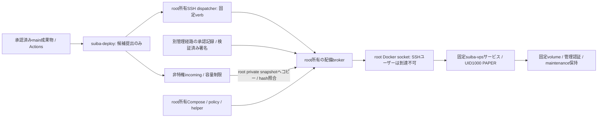

# さくらVPS: Dockerソケットを配備ユーザーへ渡さない設計案

2026-10-31、日本時間。基準main `7cf204a`。**設計書のみ・未実装・実行不可**。
PR #33 HEAD `2812298a04e8f10c4c2fefc0ad2b5ae4c63418ff` の最終レビューと、
実デプロイ前の権限分離案を記す。PR #33のコード・HEADは変更しない。

VPS接続、鍵登録、Environment/Secrets設定、実デプロイ、実Worker/Bot起動、
maintenance解除、LIVE取引は禁止を継続する。以下の将来構成は実行許可ではない。

## 1. PR #33の最終レビュー

判定: **環境準備PRとしてマージ可**。マージはユーザーの別途判断を待つ。
実接続や最小権限デプロイが実証済みという判定ではない。

| 確認           | 結果・根拠                                                                                                                                                                                  |
| -------------- | ------------------------------------------------------------------------------------------------------------------------------------------------------------------------------------------- |
| 対象           | PR #33のremote HEADとローカルHEADが2812298で一致、mainは7cf204a、競合なし                                                                                                                   |
| CI             | [WorkerなしCI #41173785488](https://github.com/tajumaru/SuiBa/actions/runs/41173785488)成功。型/build/ユニット/SSHモック13件/ShellCheck/Compose/Dockerダミー検証。通常validate/deployはskip |
| 遠隔コマンド   | id、test、docker --version、docker compose version --short、dpkg-query、awkによるmeminfo読取、df、printfのみ。sudo/daemon接続/ファイル変更/scp/compose up/Worker起動なし                    |
| ローカルrunner | 一時鍵/known_hosts/応答ファイルの作成・削除は行う。これはVPS変更ではない。認証接続によるサーバー監査ログ等の通常の副作用まで「無書込」と保証するものではない                                |
| 制限           | dispatchのみ、main、CHECK-SSH-ONLY、Repository variable=true、Environment sakura-vps。既定無効。接続先ユーザー照合、root/ubuntu拒否、固定ホスト鍵、対話/agent/転送禁止                      |
| ログ           | raw応答・鍵・接続先・ユーザー名を出さず、検証済みの版/容量のみ出力。秘密情報を含む可能性のあるエラーは固定文言にする                                                                        |
| 保持           | 既存VPS deploy条件、Worker、安全停止、管理認証、Profit Guard、RiskEngine、PAPER限定、既存フルCIに差分なし                                                                                   |

**重要な限界（接続有効化前の確認事項）:**

- Workflowの読み取り限定は、SSH鍵自体の読み取り限定ではない。authorized_keysの
  `restrict` はPTY/転送等を禁止するが、任意コマンド実行そのものは許可する。
  鍵を本当に確認専用にするには、root所有の固定preflightへのforced-command等が必要。
  専用ユーザーは非root・sudoなし・dockerグループなしを維持する。
- 現行preflightは通常shell経由で固定コマンドを実行するため、ホスト上のshell設定・
  Docker CLI/Compose plugin・システムバイナリが信頼できることが前提。CLIの版照会を
  「ホスト上で任意のDocker関連コードも実行されない」とは表現しない。
- Engineパッケージ版は、稼働Engineの版やdaemon権限の証明ではない。
- Environmentの実設定・ユーザー権限・VPS到達性・2GB安定性は未検証。
  必須チェックや保護設定を迂回せず、実接続は別途承認後とする。

この範囲にマージを阻害するコード上の不具合は検出していない。
後述の権限brokerはPR #33のマージ条件ではなく、実デプロイ有効化前の別設計・受入事項。

## 2. 現行deploy-vps.shと権限の照合

対象: `docker/deploy-vps.sh`、`docker/compose.vps.yaml`、`.github/workflows/suiba-vps.yml`。

| 現行処理                                              | 必要な権限                             | 接続確認用suiba-deployでの可否                          |
| ----------------------------------------------------- | -------------------------------------- | ------------------------------------------------------- |
| releasesへのmkdir/scp、候補コード読取                 | 候補ディレクトリ書込                   | releasesだけ許可される。ただしscpはPR #33では実行しない |
| shared/deploy.lock                                    | sharedへの書込・flock                  | root管理700のままなので不可                             |
| image load/inspect、volume inspect                    | Docker daemonアクセス                  | dockerグループ/socket ACLなしでは不可                   |
| maintenance helper、停止、再起動禁止、kill、up/health | Docker daemon、対象コンテナ/volume操作 | 不可。単なるSSH確認と全く異なる能力                     |
| backupsのtar/partial/hash/fsync                       | backups書込、DB用volumeへのアクセス    | root管理700、socketなしなので不可                       |
| current link更新                                      | /opt/suiba親への書込                   | root管理755なので不可                                   |

したがってPR #33の権限を維持したまま、現行workflowでDEPLOY-PAPERを実行しても配備は完了しない。
これを解決するためのdockerグループ追加、socket ACL、sudo docker許可を自動追加しない。

現行workflowは候補と共にComposeとdeploy-vps.shも転送し、その転送スクリプトを実行する。
`/opt/suiba/releases/<SHA>` はSSHユーザーが書けるため、そこにあるコードをrootとして
起動するsudoラッパーに替えるだけでは、任意rootコード実行を許す。
候補自身が持つchecksumやrevisionラベルも、独立した出自・承認の証明にはならない。

## 3. 方法の比較

| 案                                      | 権限境界                                                                          | 評価                                                                               |
| --------------------------------------- | --------------------------------------------------------------------------------- | ---------------------------------------------------------------------------------- |
| **A: root所有の固定配備broker**         | SSHは候補提出だけ。rootの固定policyが承認済み成果物を検査し、固定サービスだけ操作 | 既存Composeを継続する場合の推奨。新たな特権境界の実装/攻撃試験が必要               |
| B: 既存のnative systemd配備             | Dockerを使わず、非login runtimeユーザーと固定unit操作の限定sudo                   | 既存実装を再利用でき、socketを完全に避ける代案。ComposeからのDB/運用移行を別途検証 |
| C: runtime専用UIDのRootless Docker      | host rootリスクを低減。SSH UIDとruntime UIDを分け、runtime socketをSSHへ渡さない  | cgroup v2/delegation、UID mapping、永続volume移行、2GB消費を実測する場合の代案     |
| Docker group/socket ACL/NOPASSWD docker | SSH主体にdaemon全権                                                               | 採用しない                                                                         |
| SSH/TLS Docker context                  | daemonへの経路を暗号化/認証するが、操作権限をサービス限定にしない                 | 最小権限の代替にはならない                                                         |
| 汎用socket proxy                        | APIパスの許可だけでは、container createのbind/capability等の引数を制限できない    | 初期案では採用しない。JSON policy全体の安全性が必要                                |

RootlessをSSHユーザー自身に持たせるだけでは、そのUIDの全コンテナ・volume・アプリ秘密への
能力を限定できない。「rootlessだから最小権限デプロイ完成」とはしない。

## 4. 推奨Aの信頼境界（案・未実装）

### 主体と保存先

| 主体/保存先             | 所有・能力                                                                                                                          |
| ----------------------- | ----------------------------------------------------------------------------------------------------------------------------------- |
| ubuntu管理者            | 固定policy/helper/unit/承認記録のinstall・更新。Actions鍵と別の認証主体                                                             |
| suiba-deploy            | sudo/dockerグループなし。root socketとruntime socketへのACLなし。incomingのみ書込。secret/backup/current/trusted releasesへ書込不可 |
| SSH dispatcher          | root所有・親も非書込。原則非特権で実行し、許可verb以外を拒否。ユーザー提供scriptは実行しない                                        |
| 配備broker              | root所有コード・固定runtime。必要な固定Docker操作だけを実装。SSHへ汎用daemon APIを返さない                                          |
| runtime Worker          | コンテナUID1000、既存管理認証/volume/PAPER固定。brokerの資格情報・backup復号鍵・Docker socketを渡さない                             |
| /var/lib/suiba-incoming | アップロード用の別領域、容量/ファイル数/時間制限。本番releaseディレクトリではない                                                   |
| /opt/suiba/releases     | 採用後のroot所有・group/other書込不可の不変成果物だけ。既存の候補転送先と役割を分ける                                               |
| /etc/suiba-deploy       | root管理のpolicy、固定Compose/helper、承認情報。候補から転送された同名ファイルは参照しない                                          |
| shared/backups/current  | broker管理。SSHユーザーには書込権限を与えない。アプリに必要なsecret読取はコンテナ内だけ                                             |

brokerへの入口は、root所有の固定プログラム1個・固定引数だけを許す限定sudo、または
peer UIDを検証するローカルIPCのどちらかを実装時に選び、受入試験する。
汎用shell、docker、systemctl全体、user-writableパスをsudoersの対象にしない。
この文書にはinstall可能なsudoersを提示せず、実装未検証の許可を先に配らない。

### SSHと転送

固定verbは `preflight-v1`、`submit-v1`、`status-v1` のような少数の完全一致命令に限定する。
SSH_ORIGINAL_COMMANDはevalしない。未知verb・追加引数・改行・引用符・シェル記号を拒否する。
preflightはroot所有の読取helperだけを実行し、配備brokerやsudoへ接続しない。

authorized_keysのforced-command/restrict等とroot所有sshd設定で、PTY・転送・user rc・
任意shell/subsystemを拒否する。鍵行をloginユーザー自身が書換可能なら制限を外せるため、
実装時は鍵の格納先/sshd設定も管理者所有にし、ユーザーが置換できないようにする。
ホームの環境設定やuser-owned pluginを特権処理の信頼元にしない。

この方式では既存の任意sshコマンド/scp/SFTPをそのまま使えない。
将来workflowで固定verb+上限付きストリーム転送等に変更する必要がある。
別鍵を必ず追加する設計にはせず、確認/配備の権限を分ける必要に応じて鍵/Environment分離を選ぶ。
その場合だけ必要Secretsと移行手順を新たにレビューする。

### 出自・承認・TOCTOU

1. SSHユーザーが申告するSHA、checksum、image tag/labelだけで採用しない。
2. 独立した管理者所有の承認記録、または検証済みの成果物署名/attestationを根拠にする。
   初期案の承認記録は管理者が別の認証経路で用意し、SSH提出主体には発行/変更できないものとする。
3. 記録はrepository、許可workflow/ref、mainの完全SHA、CI run、archive SHA256、
   単一platformのloaded image ID、期限、単調世代/transaction IDと使用状態を束縛する。
   現行docker saveの読み込み後にregistry RepoDigestが存在すると仮定しない。
4. リクエストと成果物を、上限付きでroot専用stagingへコピーして凍結し、そのコピーをhash検証する。
   sourceのsymlink/hardlink/特殊file、path traversal、所有者・親ディレクトリの置換を拒否する。
   検査後にユーザー書込可能な元ファイルを開き直さない。同じpayloadを途中で差し替えられない設計にする。
5. rootで候補archiveを無検査展開しない。展開が必要なら非特権・容量制限付きstagingで行う。
   rootは候補のshell/Node/Compose/.env/プラグインをコードやpolicyとしてloadしない。
6. 承認・digest・main到達性・期限・未使用性を再確認し、不一致/ネットワーク不明時は起動前に拒否する。
   同一実行の再試行は既存transactionを照会し、新しい承認や別SHAへすり替えない。

GitHub Environmentの人間承認とhostの採用記録は別の検証であり、同じSHA/digestに結びつける必要がある。
CI成功だけでも、Environmentが存在するだけでもhostで任意配備可能にはしない。
署名/attestationの方式・検証identity・鍵更新・オフライン時の挙動は実装前に確定する。

## 5. 既存安全処理の再利用と変更点

root所有のpolicy/helperへ分離した上で、PR #32の状態遷移と既存のデータ検証を再利用する。
**現行deploy-vps.shをそのままroot実行する提案ではない。**

1. host配備lockと、署名/承認済み成果物の検査を先に行う。未知/古いrunは対象へ触れる前に拒否。
2. trusted policyで固定volumeへmaintenanceを永続化。失敗時も再起動を禁止し停止を要求する。
3. 固定サービスだけをSIGTERM/40秒で停止。Running=false、OOMなし、exit 0、clean receipt、
   instance lock、停止runtimeを確認できなければbackup/切替へ進まない。Docker利用不能時は状態不明を明示。
4. 全DB/ペア/履歴/WAL/SHMを扱う既存の整合性検査・復元演習を維持。
   完了したbackupを確定/hash/fsync。削除・DB初期化・自動DB巻戻し・自動pruneを許可しない。
5. root所有固定Composeで対象image IDだけを差し替える。user、command、port、volume、network、
   cap/security、memory/PID、secret pathを候補の指定値へ置換しない。
   Docker socket、host全体、任意bind、privileged、host PID/network等を一切渡さない。
6. runtimeコードや検証helperを実行する必要がある場合は、承認済みimageの非root・cap drop・
   network none等の固定コンテナ内で行い、host rootのshell/Nodeとして実行しない。
7. health/identity/PAPER/停止状態を確認してからbrokerだけがcurrentを更新する。
   maintenanceは保持し、解除・start/reset・LIVEへの入口を配備APIに設けない。
8. 失敗/切断時は停止ラッチとtransactionを残し、自動再開始しない。
   cleanupで削除できるのはbrokerが生成した専用scratchだけ。本番volumeや台帳は対象外。

アプリ自身が読むDB/管理トークンに対する能力は、承認されたアプリコードにも存在する。
brokerはhost root権限の濫用を防ぐ境界であり、承認コードの悪意・アプリ侵害を無害化する保証ではない。

## 6. 既存native実装との使い分け

`deploy/linux/start-paper.sh`、`release-paper.sh`、`suiba-paper.service`、
`suiba-release.sudoers`、`apps/worker/src/linux-paper-release.ts` は既に存在する。
root所有launcher・独立したartifact検証helper・固定unitのstop/start/showという限定許可の
考え方を再利用し、同じ機能の別controllerを無条件に増やさない。

ただし既存native配備はsuiba UID、/var/lib/suiba等の別path、35秒停止、独自artifact形式を使う。
Dockerのsuiba-vps、UID1000、named volumes、40秒停止と同一設定ではない。
採用を切り替える場合はPAPER/認証/全DB保全/boot stoppedと旧系fencingを再受入する。
両方を同時起動したり、同じDB/portを共有したりしない。

## 7. 実装前の受入条件

使い捨てLinux環境で、先に非Workerの偽runtime/偽brokerで否定試験を行う。
実Workerを使う受入は起動禁止解除後に別途承認する。

- SSHユーザーからroot/runtime socket、trusted policy、承認記録、secret、backup/currentへ到達/書込できない。
- preflight鍵で任意command/SFTP/転送/PTYができず、確認コマンドにsudoや配備遷移がない。
- root-owned pathの親、ACL、group、sudo引数、環境変数、cwdを含めて境界を検査する。
- shell記号、偽SHA、偽CI、未承認digest、壊れた署名、期限切れ/再利用/古いrunを拒否する。
- ファイル差替え、symlink/hardlink、archive traversal/展開爆弾、巨大/未完了uploadを拒否する。
- 別Compose、.env、Docker context/plugin、任意mount/capability/commandへの注入を拒否する。
- 同時要求、SSH切断、broker crash、disk full、maintenance失敗、停止timeout/OOMで勝手にupしない。
- 正常終了時のみcold backup/復元検証/切替へ進み、履歴/設定/Profit Guard状態を保持する。
- 1GiB container/V8 640MiB等の既存上限を実際のhost cgroupで検証。2GBの長時間測定は別途行う。
- Secretsをログ/artifact/環境dumpへ出さず、固定状態と非秘密のreceiptだけを返す。

root broker、sudo/IPC、forced-command、承認形式、Rootless代案はいずれも今回未実装。
ソケットACLやsudo設定を先に変更するための手順書として本書を使わない。

## 8. ユーザーが次に判断する順序

1. PR #33のレビュー結果を読み、環境準備としてmainへマージするか別途判断する。今回はマージしない。
2. この別Draft PRをレビューし、Compose+brokerか、既存native配備か、Rootless+brokerかを選ぶ。
3. 実VPS設定/鍵登録/Environment/Secrets/実SSHの実施範囲を別途承認する。それまでは変更しない。
4. 承認後、新規Actions専用鍵を生成し、ubuntu管理経路で専用ユーザーと公開鍵/権限を設定する。
   既存Windows秘密鍵を転用しない。forced-commandを採用するなら、先にその実装レビューと非実機試験を完了する。
5. ホスト鍵を独立経路で照合し、Environmentのmain制限/別の承認者/自己承認禁止を確認してから5 Secretsを登録する。
6. 接続確認だけを明示承認し、既定無効スイッチを必要時だけ有効化して確認し、終了後falseに戻す。
   これを実デプロイ・Docker権限付与・Worker開始の承認へ拡張しない。
7. 将来、権限broker等の実装・否定試験・実WorkerフルCI/初回/停止/OOM/2GB検証の承認と受入を別途行う。

**現在ユーザーが行えるのはレビューと方針判断まで。禁止中のVPS操作やSecrets設定を促すものではない。**

## 根拠

- [PR #33 / HEAD 2812298](https://github.com/tajumaru/SuiBa/pull/33)
- [PR #28設計](WALRUS_SITES_CLOUD_ARCHITECTURE_20261030_JA.md)
- [既存VPS手順](SAKURA_VPS_JA.md)、[native配備](LINUX_PAPER_RELEASE_V1_JA.md)、[データ/停止安全機構](PAPER_DEPLOYMENT_SAFETY_V1_JA.md)
- [Docker Rootless](https://docs.docker.com/engine/security/rootless/)
- [Docker socketとSSH/TLS](https://docs.docker.com/engine/security/protect-access/)
- [OpenSSH authorized_keys / restrict / command](https://man.openbsd.org/sshd.8#AUTHORIZED_KEYS_FILE_FORMAT)
