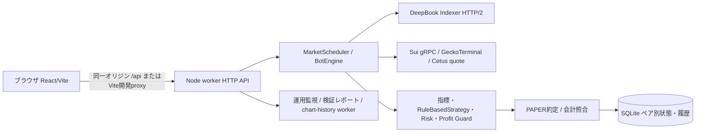
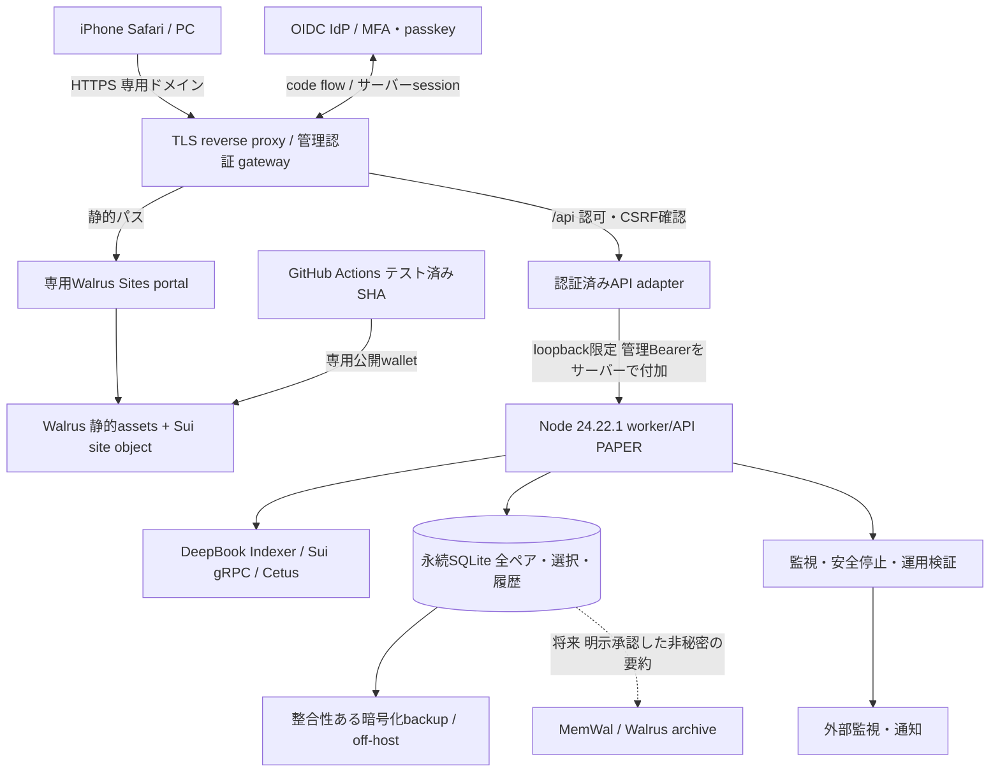

# SuiBa — Walrus Sites公開・24時間クラウド稼働 設計調査

調査日: 2026-10-30（JST）。対象: `tajumaru/SuiBa`、取得した最新 `origin/main` = `55309dc384e3455369edeeef71900bbfa9f438b0`。本書は設計案であり、実装・クラウド契約・サイト公開・LIVE有効化は行っていない。料金は調査時点の公開情報と明示した予算仮定を分けて記す。

## 1. 結論と制約

実現可能。画面はReact/Viteの静的成果物としてWalrus Sitesへ保存し、Node.js worker/APIとSQLiteを常時稼働のLinuxクラウドへ移す。WalrusはBotを実行しない。ブラウザのタイマーやiPhoneのバックグラウンド実行には依存しない。[Walrus Sites公式](https://docs.wal.app/sites)

**最小変更の推奨は案A: Linux VPS + systemd + 永続ディスク + 専用Walrusポータル + 管理認証ゲートウェイ。** 自分のドメインでWalrus由来の静的画面と `/api` を同一オリジンにする。公開 `wal.app` と別ドメインAPIを直接接続する方式は、現行Cookie/CSRF設計とSafariの制約を解決してから別段階で扱う。

必須不変条件:

- `MODE=PAPER`、非PAPER起動拒否、署名・注文送信経路なし。読み取りにMainnetを使うこととLIVE取引は別。
- ADMIN_TOKEN・秘密鍵・MemWal delegate keyをブラウザ、Vite環境変数、静的成果物、ログに置かない。
- Profit Guard、会計整合性、鮮度、API backoff/circuit、安全停止・手動再開条件を変えない。
- **プロセスを自動再起動しても、PAPER取引は自動再開しない。** 現行 `boot()` は必ず `running:false` にする。24時間の監視・待受と、無停止取引の保証は同義ではない。障害後の無人再開を追加すると本件の「安全停止を弱めない」に抵触するため対象外。
- Node.jsは現行 `>=24.22.1 <25`。25以上を「24.22.1以上だから可」と扱わない。Windows/Linuxの既存自動テストを維持する。

## 2. 現状アーキテクチャと静的公開可否

以下のパスはすべて `sui-ai-trading-bot/` 相対。コード根拠は上記SHAのファイルで、未コミットの既存設計書・別ブランチの変更は調査根拠に含めない。

| 調査対象 | 現行実装・根拠 | 公開への含意 |
|---|---|---|
| 静的画面 | `apps/dashboard/vite.config.ts`、`scripts/run-project.mjs`。`pnpm build` はtsc後Vite、出力 `apps/dashboard/dist` | SSR/Next server不要。index.html、assetsをWalrusに置ける |
| APIの相対URL | `apps/dashboard/src/main.tsx`、`verifyToken.ts`、`browserSession.ts` は `/api/...` | `wal.app`へそのまま置くとAPIが存在しない。同一オリジンgatewayかAPI接続設計が必須 |
| データ表示 | `dashboardClient.ts` のsummary/candles/records差分、checksum、legacy state fallback | 外部API化してもschema/versionと順序制御を維持 |
| 認証 | `apps/worker/src/browser-session.ts`。Bearer管理トークン、HMAC Cookie 7日、HttpOnly、SameSite=Strict、HTTPS時Secure | 現在のログインは管理トークンを手入力してsession交換する。新公開UIではこの入力経路を廃止し、管理認証はgatewayで完結させる必要あり |
| CSRF/CORS | 非GETのCookie操作は `X-SuiBa-Request:1` とsame-origin要求。CORS許可なし | CORSをワイルドカードで開く案は不可 |
| 常駐実行 | `apps/worker/src/index.ts` がlisten後scheduler開始。`scheduler.ts` は単調時刻で周期管理・過去スロットを再生しない | ブラウザを閉じても継続。Vite開発serverは本番不要 |
| AI判断 | `packages/strategy-engine/src/index.ts` は `RuleBasedStrategy`、EMA/RSI等 | 現行は外部LLM推論ではない。移行にLLM費用・GPUは不要。UIのAI表現と実装を区別する |
| PAPER/DEX | `packages/paper-trading`、`dex-router/src/index.ts` のCetus見積り、`pair-router.ts` のWAL lot/min-size検証 | DeepBook市場データを使っても、DeepBook実約定を再現するLIVEエンジンではない。約定品質に限界あり |
| 永続化 | `packages/database/src/index.ts` は `node:sqlite` のDatabaseSync、同期トランザクションとfault検出 | ローカルPOSIXディスクで単一writer。エフェメラルFS、オブジェクトストレージ直置き、共有NFSは避ける |
| 2ペア | `index.ts` のpairPath、selectionDb、pair切替 | SUIは基底DB、WALは `.WAL_USDC.sqlite`、選択DBは `.pairs.sqlite`。chart-history DBもある。ディレクトリ単位で保護 |
| 運用安全 | `operations.ts` boot、`engine.ts` order gate、`index.ts` start条件/watchdog/SIGTERM | 再起動停止、回復確認、台帳検証、緊急停止を維持 |
| 現行Docker | `docker/Dockerfile` はNode 24.22.1のdigest固定、非root。composeは3100をloopback公開、volume、30秒終了猶予 | クラウドDockerへ転用しやすいが、validation/reportsの永続化と外部監視は別途必要 |

### API依存の棚卸し

`apps/worker/src/index.ts` が実装。GET: `/healthz`（認証外）、`/api/pairs`、`chart/history`、`dashboard/summary`、`dashboard/candles`、`dashboard/records`、`state`、`operations`、`validation`、`validation/report.md`、`balances`、`backtest`。変更操作: `auth/session` のPOST/DELETE、`pairs`、`validation/start`、`backtest`、`settings`、`control`。後者は単純な閲覧APIとして公開してはならない。`X-SuiBa-Pair` によるペア競合の409も維持する。

### Node依存・ブラウザ非対応部分

HTTP server/fs/path/crypto/zlib (`worker/index.ts`)、`node:sqlite` (`database`)、`node:http2` (`market-data/deepbook-transport.ts`)、worker threads (`chart-history-client.ts`)、子プロセス (`scripts/run-project.mjs`) はサーバーに残す。一般的なEdge WorkerのWeb API環境への無変更移植は不可。画面からのBotEngine等の参照は `import type` であり、実行時Node依存を示すものではない。画面のWeb Crypto `crypto.subtle` はHTTPS必須。ビルド成功だけではAPI・ログイン・Safariの動作証明にならない。

両ペアは現行では**選択して一方を稼働**する方式。同時に2 Botを常時稼働させる場合は、プロセス・DB・port・管理経路を分離しAPI総量も再評価する追加設計が必要。本件では現行選択方式を維持する。

## 3. 推奨する最終アーキテクチャ

**設計上の境界:** assetsの正本と公開はWalrus Sites。専用portal/gatewayは通常のクラウド依存を持つ。完全に分散したAPIや無停止HAを称する構成ではない。[独自ドメイン公式](https://docs.wal.app/docs/sites/custom-domains/bringing-your-own-domain)は自前portalの配備を案内しており、DNSを `wal.app` に向けるだけの前提にしない。portalとBotのCPU/メモリを制限し、portal負荷が安全監視を圧迫するなら別ホストへ分割する。

### 公開URLと認証フロー

1. 専用HTTPSドメインで同じWalrus assetsを配信する。`/api`、認証callbackはportalへのfallbackより先にrouteする。portal自体が必要とするパスも衝突試験する。
2. 初回ログインはgatewayからIdPへトップレベル遷移。Authorization Code、state/nonce、PKCE、サーバー側code交換、利用者allowlist、MFAを使う。redirect URIは完全一致。
3. gatewayはHttpOnly/Secure/host-only Cookieで短い管理sessionを発行する。API sessionとBotの管理トークンは別。CSRF token/custom header、Origin完全一致、非GET許可リスト、再認証をgatewayで強制。
4. gateway/adapterはユーザー指定のAuthorization、転送ヘッダー、Bot Cookieを除去し、認可後にだけ内部管理Bearerを付ける。**Bearer経路はworkerのCookie CSRF判定を通らないため、gateway側のCSRF/認可が必須**。任意pathへの汎用proxyにせず、API allowlistとペア検証を行う。
5. workerはloopback/private network限定。認証なしで到達できる公開3100を作らない。TLS終端で `X-Forwarded-Proto` を上書きし外部偽装を排除。管理トークンはroot管理のsecret fileから読む。
6. 公開UIの旧トークン入力・verifyToken・Bot Cookie交換をgateway session確認へ置換する。URL query、localStorage、sessionStorage、VITE_*に管理資格情報を入れない。

これならブラウザ側は相対 `/api` と既存 `X-SuiBa-Request` を維持し、workerのsame-origin防御を緩めない。API応答はno-store、認証済み情報をportal/CDNにcacheさせない。CSPは必要なscript/style/image/connect先だけを許可し、frame-ancestors、nosniff、TLS更新を確認する。

`https://name.wal.app` の直接利用も必要なら、(a)そこは公開用非秘密のread-only情報と管理URLへのリンク、または (b)別途OAuth公開クライアント+PKCE、短命・audience制限tokenのメモリ保持、APIでJWT/JWKS検証を実装する。後者は管理トークンと別のユーザーtoken。Safariの第三者Cookieに依存する `credentials:include` + SameSite=Noneだけの案は採用しない。CORSは完全一致origin、必要method/headerのみ、OPTIONSを副作用なし処理、`Vary: Origin`、未知origin拒否。CORS自体は認証にならない。

## 4. 実行環境3案と月額費用

比較基準: 1 worker、選択ペア1つ、2 vCPU/4GBを初期目安、1か月730時間（VPS月額上限はそのまま）、USD/EUR原通貨・税別。為替換算はしない。CPU/メモリは実測で確定する。以下の「予算」は見積り仮定で、プロバイダー確約価格ではない。

| 案 | 構成 | 計算・月額目安 | 評価 |
|---|---|---|---|
| **A 推奨** | Hetzner EU x86 CX23 + systemd、TLS/auth/portal、ローカル永続SQLite | compute **€5.49/月（IPv4別）**。IPv4・backup・小容量外部保存に仮予算€3–7 → **€8.49–12.49/月 + 共通費** | Docker不要、Node HTTP/2/SQLite/threadsを維持。OS更新・証明書・監視の運用責任あり |
| B | 同じVPS + クラウド内部Docker Compose、proxy/auth/portal、named/bind volume | compute同額、運用付帯の仮予算€3–7 → **€8.49–12.49/月 + 共通費** | 既存Dockerfileを再利用し差分小。PCにDocker不要。image更新・volume backup・health復旧の管理が必要 |
| C 将来 | Nautilus on AWS Nitro + 外部API/DB/portal | 例示基準 m5.xlarge **$0.192/h ×730=$140.16/月**。EBS・IPv4・backup・proxy等の仮予算$10–30 → **$150.16–170.16/月 + 共通費**（ALB/NAT等は別） | TEE検証が必要になった段階で検討。Nautilusは無料ホスティングサービスではない。適合instance/region/購入時価格は再確認 |

A/B価格は2026-06-15改定後の[Hetzner公式表](https://docs.hetzner.com/general/infrastructure-and-availability/price-adjustment/)による。CX23は2 vCPU/4GB/40GB、[在庫状況](https://www.hetzner.com/cloud/cost-optimized/)に依存し、購入可能と断定しない。EUからのDeepBook latencyを測り、必要なら別地域の現行プランで再見積り。Cの単価根拠は[AWS公式比較表](https://docs.aws.amazon.com/prescriptive-guidance/latest/optimize-costs-microsoft-workloads/right-size-selection.html)の例示であり、リージョン別の新規見積りを代替しない。[Nitro追加料金なし](https://aws.amazon.com/ec2/nitro/nitro-enclaves/faqs/)でもEC2などは課金される。

共通費は、ドメイン/必要時SuiNS更新、IdPのプラン、外部監視、Walrus保存・書込・Sui gas・CI使用量。既存無料枠を使えるか未確認のため合計に含めていない。初期の外部LLM費用は$0（現行ルールベース）、専用RPC/有料Indexerを導入するなら別見積り。低額computeだけをサービス総額と表示しない。

### 無料枠・PaaS・Oysterとの比較

| 選択肢 | 月額と制約 | 採否 |
|---|---|---|
| Oracle Always Free | 対象枠内compute $0。容量/地域/在庫制約、低利用instance回収の可能性。backup・ドメイン等は別。[公式](https://docs.oracle.com/en-us/iaas/Content/FreeTier/freetier_topic-Always_Free_Resources.htm) | 試験用。24時間継続の主系には推奨しない。回収回避目的の人工負荷は作らない |
| Render Free | $0だが無受信15分でsleep、ローカルSQLite消失、無料diskなし、worker無料対象外。[公式](https://render.com/docs/free) | 不適合。外部pingでsleep回避を本番設計にしない |
| Render有料native runtime | 自前Dockerfile不要だが基盤はcontainer。常駐Web service + 永続diskが必要。[service種別](https://render.com/docs/service-types)。[料金ページ](https://render.com/pricing)の取得結果で数値表を確認できなかったため固定$7等を採用しない | 運用軽減候補。Node正確な版・disk単一instance・portal常駐を含むquote取得後に比較。今回は未見積り |
| Oyster isolated instance | providerが秒単価を設定。[公式課金構造](https://docs.marlin.org/oyster/protocol/cvm/workflow/provisioning-an-instance)。**月額 = 秒単価×2,628,000 + 保存/通信/取引等**。仮に$0.02/hなら$14.60/月だが市場価格を確認した値ではない | 固定価格・在庫・永続disk・再起動・attestation・支払残高を未確認。正式合計は未確定。低価格と断定せず将来PoC候補 |

Oysterは[長時間専有とserverlessの別モデル](https://docs.marlin.org/oyster/protocol/)がある。常駐scheduler+SQLiteには専有が適し、serverlessへ無変更移植しない。escrow残高切れやprovider消失を障害として扱う。Nautilus/Oysterとも可用性・backup・外部データの真実性をTEEだけで保証しない。

### Walrus費用の計算

[公式保存費用](https://docs.wal.app/docs/system-overview/storage-costs)は符号化容量に約$0.023/GB/月、原本の約4.5倍とblob当たり64MB metadataを説明する。例えば現行build約0.93MBを1 quiltにまとめる仮定では、約0.068GB × $0.023 ≈ **$0.0016/保存月/版**（十進近似）。これは保存成分だけで、write fee、gas、epoch切上げ、publisher、重複版、名前代は含まない。実費は `walrus info` とdeploy見積りで確認する。Mainnet epochは2週間、Testnetは1日。[network reference](https://docs.wal.app/docs/network-reference)

毎回全quiltを再uploadする現行site-builderでは更新回数にも比例する。期限監視・更新ジョブを用意し、期限切れを「永続公開」と誤認しない。MemWalのrelayer/embedding/Seal等の費用を、このblob保存単価だけで見積もらない。

## 5. Docker有無と運用設計

| 項目 | A: Dockerなし | B: クラウド内Docker |
|---|---|---|
| runtime | Linuxに正確なNode/pnpmを固定、専用OSユーザー | 既存digest固定image、非root user |
| 起動 | systemdから `node --import ./scripts/enforce-node-version.mjs --import tsx apps/worker/src/index.ts`、cwdはプロジェクト | 既存CMD、環境はPAPER固定 |
| 自動復旧 | systemd Restart=on-failure、再試行間隔/開始回数上限。watchdog失敗を外部監視 | restart policyは終了時に働く。unhealthyだけではDockerは再起動しないため監視側の回復手順が必要 |
| 永続化 | `/var/lib/suiba`、stateとreportに専用権限 | volume全体を保存、validation/reportsもmount。image内には状態を書かない |
| secret | ADMIN_TOKEN_FILE、OS権限、環境/ログへの展開抑止 | secret file read-only mount。image build argに入れない |
| 配備 | CIの検証済みSHAをreleaseディレクトリに配備、手動切替可能 | SHA/digestでimageを配備、旧imageへrollback可能 |

NodeをインストールするのはクラウドとCIだけ。フロントの閲覧にNodeもDockerも不要。Dockerなしの方式でも `pnpm install --frozen-lockfile` とbuildが必要。`tsx` は現行worker起動に必要なのでdevDependenciesを機械的に除外しない。コンテナとsystemdを重ねて競合するrestart制御を作らない。

### 永続化・停止・復旧

- DB、選択DB、ペア別DB、chart-history DB、SQLite WAL/SHMと検証reportを対象にする。ライブDBファイルだけの単純copyは禁止。SQLite backup API等の整合性ある手段、または正常停止後の一式copyで暗号化off-host backup。
- 単一writerを守り、旧worker停止後に新版を起動する。rolling deployで二重稼働させない。複数ホスト化にはリース/fencingとDB設計変更が必要。
- bootで `running:false`、pending中断、停止理由/緊急状態/会計記録を保持。SIGTERMでscheduler/通信/threadを閉じ25秒の強制終了上限があるため、外側は30秒以上猶予を確保する。
- プロセス障害なら自動再起動して**監視状態へ戻る**。`/healthz` は45秒heartbeat判定で、相場鮮度や台帳や取引可否の全判定ではない。業務停止を再起動で治そうとしない。
- startには接続HEALTHY、fetch停滞なし、API backoffなし、緊急/error解消、Sui healthの新しさ、会計okが必要。自動reset/startするhealth scriptは禁止。
- backup目標案: 1時間ごと、RPO 1時間、RTO 1時間。これは達成済みSLAではない。復元演習で実測。復元DBで停止状態、二重約定なし、全ペア残高、Profit Guard基準値、検証sessionの連続性/中断が正しく表示されることを確認。
- 通知対象: process/host停止、heartbeat欠落、upstream 429/timeout、market stale、DB fault/disk容量、証明書期限、backup失敗、Walrus期限。通知にtoken/body/private addressを載せない。管理UIが落ちてもホストからservice停止できる経路を確保。

## 6. DeepBookデータ・AI分析の安定性

`market-data/deepbook.ts` は公式Indexerからpool/market/ローソク足等を取得し、ペア/coin、lot/min-size、遅延などを検証する。`deepbook-transport.ts` は固定origin・GETのみ、HTTP/2再利用、GOAWAY時の再接続、8秒上限を持つ。`shared/api.ts` の一般上限は10秒、maxWait 60秒、maxRetries 2、circuit 3失敗で30–60秒。移行で値を緩めない。

SUIの既定providerはGeckoTerminal、WALはDeepBook固定。`auto` はSUIの系列fallbackを許すため、DeepBook検証をする段階は明示的にstrictを選ぶ。異なるソースの足を無表示で混ぜない。再構成はoff/verifiedの既存条件を守り、欠損を捏造しない。indexer成功HTTPとデータ鮮度は別に評価する。[DeepBook Indexer公式](https://www.docs.sui.io/onchain-finance/deepbook/deepbookv3/deepbookv3-indexer)

クラウド候補地でDNS/TCP/TLS/HTTP2再利用、p50/p95/p99、timeout、429、indexer lag、閉足時刻、cycle duration、event-loop遅延を測る。バックテストや履歴転送が監視を圧迫しないか同時負荷を試験。公開IndexerのSLA・独占rate limitは未確認なので保証しない。複数ブラウザのpollで市場取得を増やさず、workerで共有した結果を配信する。

Sui側は現行 `@mysten/sui 2.37.0` のread-only gRPCを維持する。gRPC/GraphQLはGAで、JSON-RPCへの新規依存は追加しない。[データアクセス公式](https://docs.sui.io/concepts/data-access)。履歴検索や専用RPC導入は用途ごとに設計し、failover時もネットワーク/coin/鮮度検証を省略しない。

現行AIは決定的ルールであり、同一入力の決定・risk/guard・quote・会計の出力一致を移行テストの中心とする。将来LLMを加える場合も、timeout/異常応答時WAIT、提案のみ、安全判定を迂回不可にする。長時間外部推論をschedulerの安全監視経路へ直結しない。

## 7. Sui Move / Sessions / Nautilus / Walrus Memory

### Sui Moveへ移せるもの

将来の明示的な別案件では、保管額上限、許可pool、notional上限、nonce、期限、on-chain停止フラグ、実行前の価格制約、監査hash等をMoveで強制できる。ただし実際の取引入口がそのwrapperを必ず通る設計と監査が必要で、横から標準契約を直接呼べるなら制約は強制できない。

HTTPデータ取得、24時間scheduler、LLM、全ローソク足計算、SQLite、復旧backup、UIはオフチェーンに残す。Move自体はタイマーで起動せず、外部送信とgasが必要。外部価格の真実性も自動で保証しない。現行Profit Guardは含み損益/quoteとローカル状態に依存するため丸ごと移植せず、まずオフチェーン計算と独立した最終上限検査を分ける。**今回Move配備もトランザクション送信も追加しない。**

### DeepBook Sessions

現行repoにはDeepBook SDK依存/Session連携がなく、PAPERには不要。将来の調査基準は[Sessions契約公式](https://www.docs.sui.io/onchain-finance/deepbook/deepbook-predict/contract-information/sessions)と[SDK公式](https://www.docs.sui.io/onchain-finance/deepbook/deepbook-predict-sdk/sessions)。BalanceManagerのTradeCapと新しいcanonical accountのSessionsを同じ機構とみなさない。

Sessionsはownerが一時addressと失効時刻を承認する。session側は所有者権限での出金や自己延長はできないが、**取引額・pool/market・損失の上限はgrant自体にない**。出金不可でも悪い価格で口座全体を損なえる。失効/revokeは既存注文・positionを取り消さない。

導入条件は、対応するaccount wrapper/registry app承認、networkごとのpackage call target/original ID/version watermarkとSDK版の再確認、ownerによるgrant/revoke、session専用keyのサーバーsecret保管、短命期限と失効監視、独立資金上限と別途強制制約、注文取消/残positionの停止手順。公式SDKはmainnet対応に2.8.0以降等の条件を示すが、repoにそのまま追加可能とは未検証。IDをここからコピーしてLIVE設定を作らない。PAPER受入ではgrant/key生成/署名も実施しない。

### Nautilus / Oyster

[Nautilus公式手順](https://docs.sui.io/sui-stack/nautilus/using-nautilus)はAWS Nitro Enclaves配備を前提とする。再現可能imageとattestation、計測値に結び付けた鍵開放、必要なら結果署名を将来のAI判断証明に使える。ただしenclaveは直接通常ネットワーク/永続diskを持たず、parent/vsock proxy・外部保存・再起動時再構築が必要。現行worker全体よりも「判断関数 + 検証可能な入力」の小範囲を先に分離する。Docker imageからenclave imageを作る手順もあり、「クラウドでもDockerを一切使わない」条件とは別に評価する。Oysterも同様にinput真正性とhost可用性は別課題。

### Walrus Memoryと取引履歴

[MemWal公式repo](https://github.com/MystenLabs/MemWal)はbeta。SDKのremember/recallとdelegate key、namespaceを使った将来連携を検討できる。単なるWalrus blob保存と、意味検索/暗号化/relayerを含むMemWalは別の層。

SQLiteを取引台帳の正本とする。Walrusへは日次の暗号化・hash付きPAPER監査bundle、MemWalへは**ユーザーが保存を明示承認した**戦略評価・失敗原因・改善要約だけを送る。自動保存offを初期値とし、本調査では一切保存しない。秘密鍵、token、cookie、認証header、secret入りURLは送らない。

namespaceを環境/ペア/戦略版ごとに分け、decision/cycle ID・source time・code SHA・schema・根拠hashで追跡。DB outbox等で重複防止と再送を設計し、remember jobの完了を確認してからarchive済みとする。MemWal障害は記憶だけを停止し取引の注文gateを緩めない。recall結果を信頼済み命令や会計値にせず参考資料として扱い、取り込み前に現行risk設定で検証。削除と暗号鍵失効とblob保存期限は別であり、保存前にアクセス・保持期間を説明する。

## 8. GitHub ActionsからのWalrus自動配備設計

今回はworkflowを追加しない。既存 `.github/workflows/suiba-offline.yml`（Node24.22.1、Ubuntu/Windows、typecheck/build/offline test）を残し、後続実装で以下を加える。

1. PRは公開鍵不要のテスト/build/静的secret検査のみ。fork PRやpull_request_targetの未信頼コードにsecretを渡さない。
2. mainに**通常PRで**取り込まれた検証済みSHAをdeployment対象とする。本調査ではmainへ直接commit/mergeしない。checkout/setup-node/pnpm/deploy actionを監査済みcommit SHAでpin、lockfile固定。Nodeは24.22.1または別PRで検証済み24系patch。
3. `sui-ai-trading-bot` をcwdとしてinstall/typecheck/build/test。DISTは `sui-ai-trading-bot/apps/dashboard/dist` のみ。環境・DB・report・source mapの秘密情報・keystoreを混入させない。bot本体の自動配備とは別job/別権限。
4. [公式Deploy action](https://docs.wal.app/docs/sites/ci-cd/github-actions-workflow)の `MystenLabs/walrus-sites-github-actions/deploy` を使用。専用公開walletの `SUI_KEYSTORE` はEnvironment Secret、`SUI_ADDRESS` はvariable。Bot用資格情報は不要。公開walletへ最低限のSUI/WALのみ補充し、取引用鍵と共有しない。
5. mainnet/testnet、EPOCHS、site-builder版、サイトobject IDを明示。`ws-resources.json` をpublicからdistへcopyするかobject IDを明示し、再配備で新規siteを乱造しない。自動更新は別PRで追跡しmainへ直接書かない。
6. `concurrency`で同一siteの配備を直列化。build/testはcontents:read、resource追跡PR作成だけcontents/pull-requests:write。Environment承認と予算上限を設計し、公開walletの残高・期限を監視。
7. 成功後にobject ID、assets hash、公開URL、commit SHAを記録。HTML/assets/APIログイン/管理停止までsmoke。失敗は未公開扱いにし、旧版を継続。rollbackは旧assetsを同じsiteへ再公開し、DBは勝手に巻き戻さない。

公開 `wal.app` は現行production案内に従いMainnet+SuiNSを前提とする。公式componentsページにはobject-IDアクセスの説明もあり記載が一致しないため、実際の利用条件は公開前に再検証する。[production checklist](https://docs.wal.app/docs/sites/production)。独自portalのTestnet previewを使う場合も常時公開用クラウドが必要で、Testnet保存は消去されうる。Mainnetへのサイト保存にgasを払ってもPAPER取引制約は変わらない。

## 9. 最小変更の段階的移行計画

| 段階 | 作業（後続PR） | 次へ進む条件 |
|---|---|---|
| 0 本調査 | main固定・依存/安全機構確認・設計比較 | 本書レビュー、構成と月予算を決定 |
| 1 クラウドPAPER単体 | AまたはB、正確なNode、private API、全DB/report永続化、backup、外部監視 | ブラウザなしの24h監視、停止/復旧/台帳一致。最初はDBを本番から移さずfixture |
| 2 公開認証 | OIDC gateway/API adapter、UIの旧管理token入力置換、TLS、同一origin | 認証/認可/CSRF/secret非露出、Safari実機。未認可start不可 |
| 3 Walrus preview | 静的assetsだけをWalrus保存、専用portal、route/cache/header | UI主要機能、deep link、asset hash、API非cache、証明書正常 |
| 4 CI配備 | 別PRで公式action、公開wallet分離、resource tracking、期限更新 | PR testとpublish権限分離、旧版復元、期限/残高通知 |
| 5 運用検証 | SUIとWALを各24h以上、現行validatorの測定要件で評価 | 非稼働時間を稼働実績に加算しない。失敗/中断を隠さず、GO基準を変えない |
| 6 任意拡張 | MemWal明示保存、Move/Session/TEEは独立設計 | PAPERのままPoC可能な範囲だけ。LIVEは本計画の受入条件に含めない |

最初は単一writer・単一選択ペアの現行機能を維持。2ペア同時取引、Postgres移行、分散scheduler、LLM追加は最小移行の必須作業にしない。既存DB移行時は停止して一式backup、秘密情報を除去したうえで暗号化転送、起動停止状態で照合してから手動PAPER開始。

## 10. 既存機能への影響・リスク

| 影響/リスク | 重大度 | 対策・受入証拠 |
|---|---|---|
| 静的サイトのみ配備でAPI消失 | 高 | 同一origin `/api` routing、summary/control等の実機試験 |
| gatewayが内部BearerでCSRF/認可を迂回 | 高 | gatewayで認証・Origin・CSRF・API/method制限、public3100拒否 |
| bundleへtoken/鍵流出 | 高 | 旧入力経路置換、成果物/ログ検査、server secret限定 |
| 自動再起動で安全停止解除 | 高 | boot stopped保持、auto reset/start禁止、停止理由sticky検証 |
| SQLite消失/ロック/二重writer | 高 | 永続disk、単一instance、backup復元、BUSY/IO失敗gate維持 |
| ペア混在・同時稼働の誤認 | 高 | 現行選択方式、全DB保護、pair header/409、切替停止を確認 |
| データ遅延/429/欠損による誤判断 | 高 | 既存閾値とstrict検証、未知は停止、取得成功と鮮度を分離 |
| Profit Guard基準/設定/台帳が移行で初期化 | 高 | fixture比較と復元照合、勝手なreset禁止 |
| 認証切れ/通信断がBot停止を意味すると誤表示 | 中 | stale表示・server状態分離、再接続で実状態を取得 |
| 単一VPS/portal障害、DDoS | 中 | 外部監視・資源制限・復旧手順。HAではないことを明示 |
| 更新時DB互換性・検証履歴破損 | 高 | SHA固定、停止切替、事前backup、schema変更時別rollback計画 |
| Walrus期限切れ・site ID紛失 | 中 | 同一ID管理、期限更新、公開後smoke |
| Safari Cookie/HTTPS/Web Crypto差異 | 高 | 同一origin推奨、実機ログイン/再開、第三者Cookieに非依存 |
| TEE/Sessions/記憶を安全性保証と誤認 | 高 | 別PR・別評価。権限上限/入力証明/保存承認を独立検証 |

## 11. PAPER限定の受け入れテスト計画

テストはCodexが再現可能なコマンド/fixtureで実行し、既存の安全テストを残す。以下は今後の実装・配備時の受入条件であり、クラウド実機検証済みとは記さない。

| ID | 操作・障害 | 合格条件 |
|---|---|---|
| P01 | MODE=LIVE、他modeで起動 | DB/server開始前にONLY_PAPER_SUPPORTED。署名/execute/send発生0。既存 `paper-only.test.ts` 維持 |
| P02 | 同じ入力でmainと移行版を比較 | decision、指標、risk、Profit Guard、quote検証、PAPER残高/約定/会計が一致 |
| P03 | 新規起動/正常終了/kill/host再起動 | 自動的にプロセスのみ復旧、running=false、pending処理と停止理由適正。未確認取引を再送しない |
| P04 | emergency/stop/reset/start、API backoff、Sui stale、会計不一致 | 既存gateと409を維持。reload/rebootでemergencyを解除しない。reset後もstart条件必須 |
| P05 | DNS/TLS/HTTP2 GOAWAY、429/Retry-After、5xx、8秒timeout、stale足/板/Indexer、DB fault | 閾値を変えず停止/WAIT、有限retry、回復条件前に注文なし。API errorに秘密情報なし |
| P06 | SUI_USDCとWAL_USDCを順に切替・再起動 | DB/quote/coin/lot/min-size/履歴/guardがペアごとに一致。古いpair headerは409。別ペア取引なし |
| P07 | 同じペアで24h×2回以上、ブラウザ全閉・Windows電源off | scheduler/監視/検証記録がクラウドで継続。ネット障害停止時間は稼働扱いにしない。SUI/WALそれぞれの24h条件を満たす |
| P08 | iPhone Safari実機・PC、reload、background復帰、session失効 | ログイン/閲覧/設定/安全停止可能。古い表示をstaleと示し、サーバーBot状態にUIを合わせる。手入力管理token不要 |
| P09 | 未認証・他利用者・偽Origin・CSRF・偽転送header・public3100・未知API | 許可なしの管理操作すべて拒否。gatewayへの直接Bearer持込でも昇格しない |
| P10 | dist/HTML/JS/map/storage/network response/log scan | 管理token/秘密鍵0、secret入りURL0。CookieはHttpOnly/Secure、認証応答no-store、Vite設定にsecretなし |
| P11 | backup復元/容量満杯/DB read-only/ロック/破損 | 安全停止、残高/履歴/guard一致、復旧後手動開始。RPO/RTOを実測して目標内 |
| P12 | portal停止、API停止、証明書/保存期限、CI失敗、旧版公開 | 適切な通知。asset/API失敗の区別。配備失敗で旧版維持、site ID一致、DBの無断巻戻しなし |
| P13 | 将来MemWal失敗/悪意あるrecall | 保存承認なしの送信0、秘密0、記憶がriskや会計を変更しない。Sessions/Move/LIVE署名0 |

既存Vitestの `core`、`profit-guard*`、`paper-recovery*`、`circuit-*`、`deepbook-*`、`wal-pair`、`browser-session*`、`sqlite-lock`、`node-version` を維持。認証、mobile-recovery、operations、history、safetyのPlaywright設定にgateway/HTTPS fixtureを加え、実Safariも別途試験する。offline suiteが除外するloopback/実通信テストを合格済みと扱わず、後続CIで `pnpm test` と必要なE2Eを別jobとして実行する。24hはシミュレーションと実測を区別し、現行validatorが要求する活動/サンプル/運用証拠の不足を時間経過だけでGOにしない。

## 12. 今回の確認結果と未確認事項

- 既存作業ツリーに変更を加えず、最新mainから調査専用worktree/branchを作成。変更対象は本Markdownのみ。
- ローカルNode実体 `v24.22.1`、pnpm `9.12.3`。`pnpm install --frozen-lockfile --offline` 成功。lockfileの変更なし。
- `pnpm build` 成功（tsc含む）。Vite 7.3.7、219 modules。Zodの注釈と500kB超JS chunkの警告あり、build失敗ではない。静的成果物の生成まで確認し、Walrusアップロードは未実行。
- `pnpm test:offline`: Node標準test 45件成功、Vitest 74ファイル成功、1,076件成功・8件skip。初回はsandboxの既定TEMPでreportのatomic renameにEPERMが1件発生（1,075件成功）。TEMP/TMPを専用worktree内 `.test-tmp` へ向けた再実行で全対象成功。コード・テスト・閾値の変更はしていない。skipとoffline除外分の成功を主張しない。
- Linux実機、クラウド、Safari実機、24h実測、外部APIの可用性/地域遅延、portal配備、実料金quoteは今回未検証。
- Node互換性は24.22.1での今回build/testと、mainにあるUbuntu/Windows CI定義までを根拠とする。将来の全24系patchや全OSでの成功は保証せず、更新時に同じsuiteを通す。

## 13. 主要一次資料（2026-10-30参照）

本文のリンクは調査根拠。コードは[main固定SHA](https://github.com/tajumaru/SuiBa/tree/55309dc384e3455369edeeef71900bbfa9f438b0/sui-ai-trading-bot)で追跡する。料金・公開仕様・package/version/registry許可は変わり得るため、実装PRと公開直前に再検証する。Oyster市場価格、PaaS数値、MemWal総費用など取得できなかった値は推測を確定価格として記載していない。
