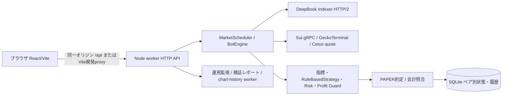
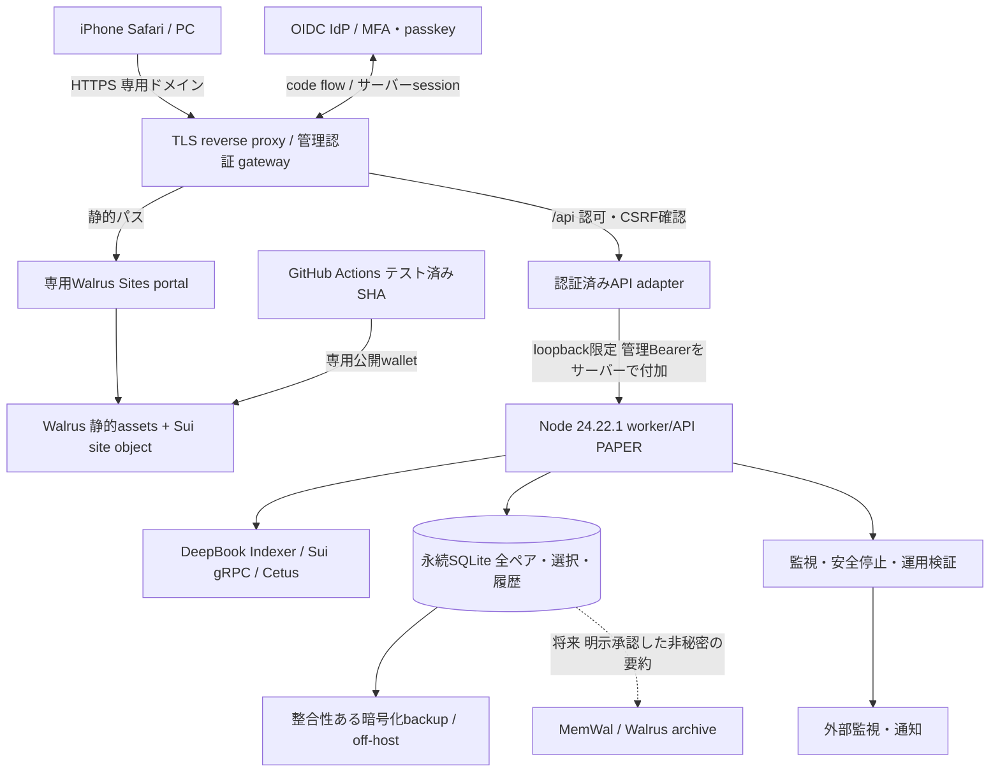
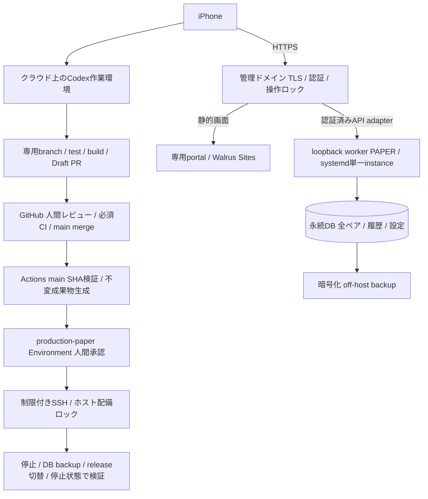

# SuiBa — Walrus Sites公開・24時間クラウド稼働 設計調査

> **改訂案内:** PR #28の最新main取り込み・国内VPS比較・承認付きリリース設計・今回の検証結果は14〜20章を参照。1〜13章は初回調査時点の記録と代替案を保持する。今回の推奨は国内VPS4GBで、実装・公開・LIVE有効化の承認ではない。

調査日: 2026-10-30（JST）。対象: `tajumaru/SuiBa`、取得した最新 `origin/main` = `d5a664d60c85266538d1f6655e40cafab11dbbbc`。本書は設計案であり、実装・クラウド契約・サイト公開・LIVE有効化は行っていない。料金は調査時点の公開情報と明示した予算仮定を分けて記す。

## 1. 結論と制約

実現可能。画面はReact/Viteの静的成果物としてWalrus Sitesへ保存し、Node.js worker/APIとSQLiteを常時稼働のLinuxクラウドへ移す。WalrusはBotを実行しない。ブラウザのタイマーやiPhoneのバックグラウンド実行には依存しない。[Walrus Sites公式](https://docs.wal.app/sites)

**最小変更の推奨は案A: Linux VPS + systemd + 永続ディスク + 専用Walrusポータル + 管理認証ゲートウェイ。** 自分のドメインでWalrus由来の静的画面と `/api` を同一オリジンにする。公開 `wal.app` と別ドメインAPIを直接接続する方式は、現行Cookie/CSRF設計とSafariの制約を解決してから別段階で扱う。

必須不変条件:

- `MODE=PAPER`、非PAPER起動拒否、署名・注文送信経路なし。読み取りにMainnetを使うこととLIVE取引は別。
- ADMIN_TOKEN・秘密鍵・MemWal delegate keyをブラウザ、Vite環境変数、静的成果物、ログに置かない。
- Profit Guard、会計整合性、鮮度、API backoff/circuit、安全停止・手動再開条件を変えない。
- **プロセスを自動再起動しても、PAPER取引は自動再開しない。** 現行 `boot()` は必ず `running:false` にする。24時間の監視・待受と、無停止取引の保証は同義ではない。障害後の無人再開を追加すると本件の「安全停止を弱めない」に抵触するため対象外。
- Node.jsは現行 `>=24.22.1 <25`。25以上を「24.22.1以上だから可」と扱わない。Windows/Linuxの既存自動テストを維持する。

## 2. 現状アーキテクチャと静的公開可否

以下のパスはすべて `sui-ai-trading-bot/` 相対。コード根拠は上記SHAのファイルで、未コミットの既存設計書・別ブランチの変更は調査根拠に含めない。

| 調査対象 | 現行実装・根拠 | 公開への含意 |
|---|---|---|
| 静的画面 | `apps/dashboard/vite.config.ts`、`scripts/run-project.mjs`。`pnpm build` はtsc後Vite、出力 `apps/dashboard/dist` | SSR/Next server不要。index.html、assetsをWalrusに置ける |
| APIの相対URL | `apps/dashboard/src/main.tsx`、`verifyToken.ts`、`browserSession.ts` は `/api/...` | `wal.app`へそのまま置くとAPIが存在しない。同一オリジンgatewayかAPI接続設計が必須 |
| データ表示 | `dashboardClient.ts` のsummary/candles/records差分、checksum、legacy state fallback | 外部API化してもschema/versionと順序制御を維持 |
| 認証 | `apps/worker/src/browser-session.ts`。Bearer管理トークン、HMAC Cookie 7日、HttpOnly、SameSite=Strict、HTTPS時Secure | 現在のログインは管理トークンを手入力してsession交換する。新公開UIではこの入力経路を廃止し、管理認証はgatewayで完結させる必要あり |
| CSRF/CORS | 非GETのCookie操作は `X-SuiBa-Request:1` とsame-origin要求。CORS許可なし | CORSをワイルドカードで開く案は不可 |
| 常駐実行 | `apps/worker/src/index.ts` がlisten後scheduler開始。`scheduler.ts` は単調時刻で周期管理・過去スロットを再生しない | ブラウザを閉じても継続。Vite開発serverは本番不要 |
| AI判断 | `packages/strategy-engine/src/index.ts` は `RuleBasedStrategy`、EMA/RSI等 | 現行は外部LLM推論ではない。移行にLLM費用・GPUは不要。UIのAI表現と実装を区別する |
| PAPER/DEX | `packages/paper-trading`、`dex-router/src/index.ts` のCetus見積り、`pair-router.ts` のWAL lot/min-size検証 | DeepBook市場データを使っても、DeepBook実約定を再現するLIVEエンジンではない。約定品質に限界あり |
| 永続化 | `packages/database/src/index.ts` は `node:sqlite` のDatabaseSync、同期トランザクションとfault検出 | ローカルPOSIXディスクで単一writer。エフェメラルFS、オブジェクトストレージ直置き、共有NFSは避ける |
| 2ペア | `index.ts` のpairPath、selectionDb、pair切替 | SUIは基底DB、WALは `.WAL_USDC.sqlite`、選択DBは `.pairs.sqlite`。chart-history DBもある。ディレクトリ単位で保護 |
| 運用安全 | `operations.ts` boot、`engine.ts` order gate、`index.ts` start条件/watchdog/SIGTERM | 再起動停止、回復確認、台帳検証、緊急停止を維持 |
| 現行Docker | `docker/Dockerfile` はNode 24.22.1のdigest固定、非root。composeは3100をloopback公開、volume、30秒終了猶予 | クラウドDockerへ転用しやすいが、validation/reportsの永続化と外部監視は別途必要 |

### API依存の棚卸し

`apps/worker/src/index.ts` が実装。GET: `/healthz`（認証外）、`/api/pairs`、`chart/history`、`dashboard/summary`、`dashboard/candles`、`dashboard/records`、`state`、`operations`、`validation`、`validation/report.md`、`balances`、`backtest`。変更操作: `auth/session` のPOST/DELETE、`pairs`、`validation/start`、`backtest`、`settings`、`control`。後者は単純な閲覧APIとして公開してはならない。`X-SuiBa-Pair` によるペア競合の409も維持する。

### Node依存・ブラウザ非対応部分

HTTP server/fs/path/crypto/zlib (`worker/index.ts`)、`node:sqlite` (`database`)、`node:http2` (`market-data/deepbook-transport.ts`)、worker threads (`chart-history-client.ts`)、子プロセス (`scripts/run-project.mjs`) はサーバーに残す。一般的なEdge WorkerのWeb API環境への無変更移植は不可。画面からのBotEngine等の参照は `import type` であり、実行時Node依存を示すものではない。画面のWeb Crypto `crypto.subtle` はHTTPS必須。ビルド成功だけではAPI・ログイン・Safariの動作証明にならない。

両ペアは現行では**選択して一方を稼働**する方式。同時に2 Botを常時稼働させる場合は、プロセス・DB・port・管理経路を分離しAPI総量も再評価する追加設計が必要。本件では現行選択方式を維持する。

## 3. 推奨する最終アーキテクチャ

**設計上の境界:** assetsの正本と公開はWalrus Sites。専用portal/gatewayは通常のクラウド依存を持つ。完全に分散したAPIや無停止HAを称する構成ではない。[独自ドメイン公式](https://docs.wal.app/docs/sites/custom-domains/bringing-your-own-domain)は自前portalの配備を案内しており、DNSを `wal.app` に向けるだけの前提にしない。portalとBotのCPU/メモリを制限し、portal負荷が安全監視を圧迫するなら別ホストへ分割する。

### 公開URLと認証フロー

1. 専用HTTPSドメインで同じWalrus assetsを配信する。`/api`、認証callbackはportalへのfallbackより先にrouteする。portal自体が必要とするパスも衝突試験する。
2. 初回ログインはgatewayからIdPへトップレベル遷移。Authorization Code、state/nonce、PKCE、サーバー側code交換、利用者allowlist、MFAを使う。redirect URIは完全一致。
3. gatewayはHttpOnly/Secure/host-only Cookieで短い管理sessionを発行する。API sessionとBotの管理トークンは別。CSRF token/custom header、Origin完全一致、非GET許可リスト、再認証をgatewayで強制。
4. gateway/adapterはユーザー指定のAuthorization、転送ヘッダー、Bot Cookieを除去し、認可後にだけ内部管理Bearerを付ける。**Bearer経路はworkerのCookie CSRF判定を通らないため、gateway側のCSRF/認可が必須**。任意pathへの汎用proxyにせず、API allowlistとペア検証を行う。
5. workerはloopback/private network限定。認証なしで到達できる公開3100を作らない。TLS終端で `X-Forwarded-Proto` を上書きし外部偽装を排除。管理トークンはroot管理のsecret fileから読む。
6. 公開UIの旧トークン入力・verifyToken・Bot Cookie交換をgateway session確認へ置換する。URL query、localStorage、sessionStorage、VITE_*に管理資格情報を入れない。

これならブラウザ側は相対 `/api` と既存 `X-SuiBa-Request` を維持し、workerのsame-origin防御を緩めない。API応答はno-store、認証済み情報をportal/CDNにcacheさせない。CSPは必要なscript/style/image/connect先だけを許可し、frame-ancestors、nosniff、TLS更新を確認する。

`https://name.wal.app` の直接利用も必要なら、(a)そこは公開用非秘密のread-only情報と管理URLへのリンク、または (b)別途OAuth公開クライアント+PKCE、短命・audience制限tokenのメモリ保持、APIでJWT/JWKS検証を実装する。後者は管理トークンと別のユーザーtoken。Safariの第三者Cookieに依存する `credentials:include` + SameSite=Noneだけの案は採用しない。CORSは完全一致origin、必要method/headerのみ、OPTIONSを副作用なし処理、`Vary: Origin`、未知origin拒否。CORS自体は認証にならない。

## 4. 実行環境3案と月額費用

比較基準: 1 worker、選択ペア1つ、2 vCPU/4GBを初期目安、1か月730時間（VPS月額上限はそのまま）、USD/EUR原通貨・税別。為替換算はしない。CPU/メモリは実測で確定する。以下の「予算」は見積り仮定で、プロバイダー確約価格ではない。

| 案 | 構成 | 計算・月額目安 | 評価 |
|---|---|---|---|
| **A 推奨** | Hetzner EU x86 CX23 + systemd、TLS/auth/portal、ローカル永続SQLite | compute **€5.49/月（IPv4別）**。IPv4・backup・小容量外部保存に仮予算€3–7 → **€8.49–12.49/月 + 共通費** | Docker不要、Node HTTP/2/SQLite/threadsを維持。OS更新・証明書・監視の運用責任あり |
| B | 同じVPS + クラウド内部Docker Compose、proxy/auth/portal、named/bind volume | compute同額、運用付帯の仮予算€3–7 → **€8.49–12.49/月 + 共通費** | 既存Dockerfileを再利用し差分小。PCにDocker不要。image更新・volume backup・health復旧の管理が必要 |
| C 将来 | Nautilus on AWS Nitro + 外部API/DB/portal | 例示基準 m5.xlarge **$0.192/h ×730=$140.16/月**。EBS・IPv4・backup・proxy等の仮予算$10–30 → **$150.16–170.16/月 + 共通費**（ALB/NAT等は別） | TEE検証が必要になった段階で検討。Nautilusは無料ホスティングサービスではない。適合instance/region/購入時価格は再確認 |

A/B価格は2026-06-15改定後の[Hetzner公式表](https://docs.hetzner.com/general/infrastructure-and-availability/price-adjustment/)による。CX23は2 vCPU/4GB/40GB、[在庫状況](https://www.hetzner.com/cloud/cost-optimized/)に依存し、購入可能と断定しない。EUからのDeepBook latencyを測り、必要なら別地域の現行プランで再見積り。Cの単価根拠は[AWS公式比較表](https://docs.aws.amazon.com/prescriptive-guidance/latest/optimize-costs-microsoft-workloads/right-size-selection.html)の例示であり、リージョン別の新規見積りを代替しない。[Nitro追加料金なし](https://aws.amazon.com/ec2/nitro/nitro-enclaves/faqs/)でもEC2などは課金される。

共通費は、ドメイン/必要時SuiNS更新、IdPのプラン、外部監視、Walrus保存・書込・Sui gas・CI使用量。既存無料枠を使えるか未確認のため合計に含めていない。初期の外部LLM費用は$0（現行ルールベース）、専用RPC/有料Indexerを導入するなら別見積り。低額computeだけをサービス総額と表示しない。

### 無料枠・PaaS・Oysterとの比較

| 選択肢 | 月額と制約 | 採否 |
|---|---|---|
| Oracle Always Free | 対象枠内compute $0。容量/地域/在庫制約、低利用instance回収の可能性。backup・ドメイン等は別。[公式](https://docs.oracle.com/en-us/iaas/Content/FreeTier/freetier_topic-Always_Free_Resources.htm) | 試験用。24時間継続の主系には推奨しない。回収回避目的の人工負荷は作らない |
| Render Free | $0だが無受信15分でsleep、ローカルSQLite消失、無料diskなし、worker無料対象外。[公式](https://render.com/docs/free) | 不適合。外部pingでsleep回避を本番設計にしない |
| Render有料native runtime | 自前Dockerfile不要だが基盤はcontainer。常駐Web service + 永続diskが必要。[service種別](https://render.com/docs/service-types)。[料金ページ](https://render.com/pricing)の取得結果で数値表を確認できなかったため固定$7等を採用しない | 運用軽減候補。Node正確な版・disk単一instance・portal常駐を含むquote取得後に比較。今回は未見積り |
| Oyster isolated instance | providerが秒単価を設定。[公式課金構造](https://docs.marlin.org/oyster/protocol/cvm/workflow/provisioning-an-instance)。**月額 = 秒単価×2,628,000 + 保存/通信/取引等**。仮に$0.02/hなら$14.60/月だが市場価格を確認した値ではない | 固定価格・在庫・永続disk・再起動・attestation・支払残高を未確認。正式合計は未確定。低価格と断定せず将来PoC候補 |

Oysterは[長時間専有とserverlessの別モデル](https://docs.marlin.org/oyster/protocol/)がある。常駐scheduler+SQLiteには専有が適し、serverlessへ無変更移植しない。escrow残高切れやprovider消失を障害として扱う。Nautilus/Oysterとも可用性・backup・外部データの真実性をTEEだけで保証しない。

### Walrus費用の計算

[公式保存費用](https://docs.wal.app/docs/system-overview/storage-costs)は符号化容量に約$0.023/GB/月、原本の約4.5倍とblob当たり64MB metadataを説明する。例えば現行build約0.93MBを1 quiltにまとめる仮定では、約0.068GB × $0.023 ≈ **$0.0016/保存月/版**（十進近似）。これは保存成分だけで、write fee、gas、epoch切上げ、publisher、重複版、名前代は含まない。実費は `walrus info` とdeploy見積りで確認する。Mainnet epochは2週間、Testnetは1日。[network reference](https://docs.wal.app/docs/network-reference)

毎回全quiltを再uploadする現行site-builderでは更新回数にも比例する。期限監視・更新ジョブを用意し、期限切れを「永続公開」と誤認しない。MemWalのrelayer/embedding/Seal等の費用を、このblob保存単価だけで見積もらない。

## 5. Docker有無と運用設計

| 項目 | A: Dockerなし | B: クラウド内Docker |
|---|---|---|
| runtime | Linuxに正確なNode/pnpmを固定、専用OSユーザー | 既存digest固定image、非root user |
| 起動 | systemdから `node --import ./scripts/enforce-node-version.mjs --import tsx apps/worker/src/index.ts`、cwdはプロジェクト | 既存CMD、環境はPAPER固定 |
| 自動復旧 | systemd Restart=on-failure、再試行間隔/開始回数上限。watchdog失敗を外部監視 | restart policyは終了時に働く。unhealthyだけではDockerは再起動しないため監視側の回復手順が必要 |
| 永続化 | `/var/lib/suiba`、stateとreportに専用権限 | volume全体を保存、validation/reportsもmount。image内には状態を書かない |
| secret | ADMIN_TOKEN_FILE、OS権限、環境/ログへの展開抑止 | secret file read-only mount。image build argに入れない |
| 配備 | CIの検証済みSHAをreleaseディレクトリに配備、手動切替可能 | SHA/digestでimageを配備、旧imageへrollback可能 |

NodeをインストールするのはクラウドとCIだけ。フロントの閲覧にNodeもDockerも不要。Dockerなしの方式でも `pnpm install --frozen-lockfile` とbuildが必要。`tsx` は現行worker起動に必要なのでdevDependenciesを機械的に除外しない。コンテナとsystemdを重ねて競合するrestart制御を作らない。

### 永続化・停止・復旧

- DB、選択DB、ペア別DB、chart-history DB、SQLite WAL/SHMと検証reportを対象にする。ライブDBファイルだけの単純copyは禁止。SQLite backup API等の整合性ある手段、または正常停止後の一式copyで暗号化off-host backup。
- 単一writerを守り、旧worker停止後に新版を起動する。rolling deployで二重稼働させない。複数ホスト化にはリース/fencingとDB設計変更が必要。
- bootで `running:false`、pending中断、停止理由/緊急状態/会計記録を保持。SIGTERMでscheduler/通信/threadを閉じ25秒の強制終了上限があるため、外側は30秒以上猶予を確保する。
- プロセス障害なら自動再起動して**監視状態へ戻る**。`/healthz` は45秒heartbeat判定で、相場鮮度や台帳や取引可否の全判定ではない。業務停止を再起動で治そうとしない。
- startには接続HEALTHY、fetch停滞なし、API backoffなし、緊急/error解消、Sui healthの新しさ、会計okが必要。自動reset/startするhealth scriptは禁止。
- backup目標案: 1時間ごと、RPO 1時間、RTO 1時間。これは達成済みSLAではない。復元演習で実測。復元DBで停止状態、二重約定なし、全ペア残高、Profit Guard基準値、検証sessionの連続性/中断が正しく表示されることを確認。
- 通知対象: process/host停止、heartbeat欠落、upstream 429/timeout、market stale、DB fault/disk容量、証明書期限、backup失敗、Walrus期限。通知にtoken/body/private addressを載せない。管理UIが落ちてもホストからservice停止できる経路を確保。

## 6. DeepBookデータ・AI分析の安定性

`market-data/deepbook.ts` は公式Indexerからpool/market/ローソク足等を取得し、ペア/coin、lot/min-size、遅延などを検証する。`deepbook-transport.ts` は固定origin・GETのみ、HTTP/2再利用、GOAWAY時の再接続、8秒上限を持つ。`shared/api.ts` の一般上限は10秒、maxWait 60秒、maxRetries 2、circuit 3失敗で30–60秒。移行で値を緩めない。

SUIの既定providerはGeckoTerminal、WALはDeepBook固定。`auto` はSUIの系列fallbackを許すため、DeepBook検証をする段階は明示的にstrictを選ぶ。異なるソースの足を無表示で混ぜない。再構成はoff/verifiedの既存条件を守り、欠損を捏造しない。indexer成功HTTPとデータ鮮度は別に評価する。[DeepBook Indexer公式](https://www.docs.sui.io/onchain-finance/deepbook/deepbookv3/deepbookv3-indexer)

クラウド候補地でDNS/TCP/TLS/HTTP2再利用、p50/p95/p99、timeout、429、indexer lag、閉足時刻、cycle duration、event-loop遅延を測る。バックテストや履歴転送が監視を圧迫しないか同時負荷を試験。公開IndexerのSLA・独占rate limitは未確認なので保証しない。複数ブラウザのpollで市場取得を増やさず、workerで共有した結果を配信する。

Sui側は現行 `@mysten/sui 2.37.0` のread-only gRPCを維持する。gRPC/GraphQLはGAで、JSON-RPCへの新規依存は追加しない。[データアクセス公式](https://docs.sui.io/concepts/data-access)。履歴検索や専用RPC導入は用途ごとに設計し、failover時もネットワーク/coin/鮮度検証を省略しない。

現行AIは決定的ルールであり、同一入力の決定・risk/guard・quote・会計の出力一致を移行テストの中心とする。将来LLMを加える場合も、timeout/異常応答時WAIT、提案のみ、安全判定を迂回不可にする。長時間外部推論をschedulerの安全監視経路へ直結しない。

## 7. Sui Move / Sessions / Nautilus / Walrus Memory

### Sui Moveへ移せるもの

将来の明示的な別案件では、保管額上限、許可pool、notional上限、nonce、期限、on-chain停止フラグ、実行前の価格制約、監査hash等をMoveで強制できる。ただし実際の取引入口がそのwrapperを必ず通る設計と監査が必要で、横から標準契約を直接呼べるなら制約は強制できない。

HTTPデータ取得、24時間scheduler、LLM、全ローソク足計算、SQLite、復旧backup、UIはオフチェーンに残す。Move自体はタイマーで起動せず、外部送信とgasが必要。外部価格の真実性も自動で保証しない。現行Profit Guardは含み損益/quoteとローカル状態に依存するため丸ごと移植せず、まずオフチェーン計算と独立した最終上限検査を分ける。**今回Move配備もトランザクション送信も追加しない。**

### DeepBook Sessions

現行repoにはDeepBook SDK依存/Session連携がなく、PAPERには不要。将来の調査基準は[Sessions契約公式](https://www.docs.sui.io/onchain-finance/deepbook/deepbook-predict/contract-information/sessions)と[SDK公式](https://www.docs.sui.io/onchain-finance/deepbook/deepbook-predict-sdk/sessions)。BalanceManagerのTradeCapと新しいcanonical accountのSessionsを同じ機構とみなさない。

Sessionsはownerが一時addressと失効時刻を承認する。session側は所有者権限での出金や自己延長はできないが、**取引額・pool/market・損失の上限はgrant自体にない**。出金不可でも悪い価格で口座全体を損なえる。失効/revokeは既存注文・positionを取り消さない。

導入条件は、対応するaccount wrapper/registry app承認、networkごとのpackage call target/original ID/version watermarkとSDK版の再確認、ownerによるgrant/revoke、session専用keyのサーバーsecret保管、短命期限と失効監視、独立資金上限と別途強制制約、注文取消/残positionの停止手順。公式SDKはmainnet対応に2.8.0以降等の条件を示すが、repoにそのまま追加可能とは未検証。IDをここからコピーしてLIVE設定を作らない。PAPER受入ではgrant/key生成/署名も実施しない。

### Nautilus / Oyster

[Nautilus公式手順](https://docs.sui.io/sui-stack/nautilus/using-nautilus)はAWS Nitro Enclaves配備を前提とする。再現可能imageとattestation、計測値に結び付けた鍵開放、必要なら結果署名を将来のAI判断証明に使える。ただしenclaveは直接通常ネットワーク/永続diskを持たず、parent/vsock proxy・外部保存・再起動時再構築が必要。現行worker全体よりも「判断関数 + 検証可能な入力」の小範囲を先に分離する。Docker imageからenclave imageを作る手順もあり、「クラウドでもDockerを一切使わない」条件とは別に評価する。Oysterも同様にinput真正性とhost可用性は別課題。

### Walrus Memoryと取引履歴

[MemWal公式repo](https://github.com/MystenLabs/MemWal)はbeta。SDKのremember/recallとdelegate key、namespaceを使った将来連携を検討できる。単なるWalrus blob保存と、意味検索/暗号化/relayerを含むMemWalは別の層。

SQLiteを取引台帳の正本とする。Walrusへは日次の暗号化・hash付きPAPER監査bundle、MemWalへは**ユーザーが保存を明示承認した**戦略評価・失敗原因・改善要約だけを送る。自動保存offを初期値とし、本調査では一切保存しない。秘密鍵、token、cookie、認証header、secret入りURLは送らない。

namespaceを環境/ペア/戦略版ごとに分け、decision/cycle ID・source time・code SHA・schema・根拠hashで追跡。DB outbox等で重複防止と再送を設計し、remember jobの完了を確認してからarchive済みとする。MemWal障害は記憶だけを停止し取引の注文gateを緩めない。recall結果を信頼済み命令や会計値にせず参考資料として扱い、取り込み前に現行risk設定で検証。削除と暗号鍵失効とblob保存期限は別であり、保存前にアクセス・保持期間を説明する。

## 8. GitHub ActionsからのWalrus自動配備設計

今回はworkflowを追加しない。既存 `.github/workflows/suiba-offline.yml`（Node24.22.1、Ubuntu/Windows、typecheck/build/offline test）を残し、後続実装で以下を加える。

1. PRは公開鍵不要のテスト/build/静的secret検査のみ。fork PRやpull_request_targetの未信頼コードにsecretを渡さない。
2. mainに**通常PRで**取り込まれた検証済みSHAをdeployment対象とする。本調査ではmainへ直接commit/mergeしない。checkout/setup-node/pnpm/deploy actionを監査済みcommit SHAでpin、lockfile固定。Nodeは24.22.1または別PRで検証済み24系patch。
3. `sui-ai-trading-bot` をcwdとしてinstall/typecheck/build/test。DISTは `sui-ai-trading-bot/apps/dashboard/dist` のみ。環境・DB・report・source mapの秘密情報・keystoreを混入させない。bot本体の自動配備とは別job/別権限。
4. [公式Deploy action](https://docs.wal.app/docs/sites/ci-cd/github-actions-workflow)の `MystenLabs/walrus-sites-github-actions/deploy` を使用。専用公開walletの `SUI_KEYSTORE` はEnvironment Secret、`SUI_ADDRESS` はvariable。Bot用資格情報は不要。公開walletへ最低限のSUI/WALのみ補充し、取引用鍵と共有しない。
5. mainnet/testnet、EPOCHS、site-builder版、サイトobject IDを明示。`ws-resources.json` をpublicからdistへcopyするかobject IDを明示し、再配備で新規siteを乱造しない。自動更新は別PRで追跡しmainへ直接書かない。
6. `concurrency`で同一siteの配備を直列化。build/testはcontents:read、resource追跡PR作成だけcontents/pull-requests:write。Environment承認と予算上限を設計し、公開walletの残高・期限を監視。
7. 成功後にobject ID、assets hash、公開URL、commit SHAを記録。HTML/assets/APIログイン/管理停止までsmoke。失敗は未公開扱いにし、旧版を継続。rollbackは旧assetsを同じsiteへ再公開し、DBは勝手に巻き戻さない。

公開 `wal.app` は現行production案内に従いMainnet+SuiNSを前提とする。公式componentsページにはobject-IDアクセスの説明もあり記載が一致しないため、実際の利用条件は公開前に再検証する。[production checklist](https://docs.wal.app/docs/sites/production)。独自portalのTestnet previewを使う場合も常時公開用クラウドが必要で、Testnet保存は消去されうる。Mainnetへのサイト保存にgasを払ってもPAPER取引制約は変わらない。

## 9. 最小変更の段階的移行計画

| 段階 | 作業（後続PR） | 次へ進む条件 |
|---|---|---|
| 0 本調査 | main固定・依存/安全機構確認・設計比較 | 本書レビュー、構成と月予算を決定 |
| 1 クラウドPAPER単体 | AまたはB、正確なNode、private API、全DB/report永続化、backup、外部監視 | ブラウザなしの24h監視、停止/復旧/台帳一致。最初はDBを本番から移さずfixture |
| 2 公開認証 | OIDC gateway/API adapter、UIの旧管理token入力置換、TLS、同一origin | 認証/認可/CSRF/secret非露出、Safari実機。未認可start不可 |
| 3 Walrus preview | 静的assetsだけをWalrus保存、専用portal、route/cache/header | UI主要機能、deep link、asset hash、API非cache、証明書正常 |
| 4 CI配備 | 別PRで公式action、公開wallet分離、resource tracking、期限更新 | PR testとpublish権限分離、旧版復元、期限/残高通知 |
| 5 運用検証 | SUIとWALを各24h以上、現行validatorの測定要件で評価 | 非稼働時間を稼働実績に加算しない。失敗/中断を隠さず、GO基準を変えない |
| 6 任意拡張 | MemWal明示保存、Move/Session/TEEは独立設計 | PAPERのままPoC可能な範囲だけ。LIVEは本計画の受入条件に含めない |

最初は単一writer・単一選択ペアの現行機能を維持。2ペア同時取引、Postgres移行、分散scheduler、LLM追加は最小移行の必須作業にしない。既存DB移行時は停止して一式backup、秘密情報を除去したうえで暗号化転送、起動停止状態で照合してから手動PAPER開始。

## 10. 既存機能への影響・リスク

| 影響/リスク | 重大度 | 対策・受入証拠 |
|---|---|---|
| 静的サイトのみ配備でAPI消失 | 高 | 同一origin `/api` routing、summary/control等の実機試験 |
| gatewayが内部BearerでCSRF/認可を迂回 | 高 | gatewayで認証・Origin・CSRF・API/method制限、public3100拒否 |
| bundleへtoken/鍵流出 | 高 | 旧入力経路置換、成果物/ログ検査、server secret限定 |
| 自動再起動で安全停止解除 | 高 | boot stopped保持、auto reset/start禁止、停止理由sticky検証 |
| SQLite消失/ロック/二重writer | 高 | 永続disk、単一instance、backup復元、BUSY/IO失敗gate維持 |
| ペア混在・同時稼働の誤認 | 高 | 現行選択方式、全DB保護、pair header/409、切替停止を確認 |
| データ遅延/429/欠損による誤判断 | 高 | 既存閾値とstrict検証、未知は停止、取得成功と鮮度を分離 |
| Profit Guard基準/設定/台帳が移行で初期化 | 高 | fixture比較と復元照合、勝手なreset禁止 |
| 認証切れ/通信断がBot停止を意味すると誤表示 | 中 | stale表示・server状態分離、再接続で実状態を取得 |
| 単一VPS/portal障害、DDoS | 中 | 外部監視・資源制限・復旧手順。HAではないことを明示 |
| 更新時DB互換性・検証履歴破損 | 高 | SHA固定、停止切替、事前backup、schema変更時別rollback計画 |
| Walrus期限切れ・site ID紛失 | 中 | 同一ID管理、期限更新、公開後smoke |
| Safari Cookie/HTTPS/Web Crypto差異 | 高 | 同一origin推奨、実機ログイン/再開、第三者Cookieに非依存 |
| TEE/Sessions/記憶を安全性保証と誤認 | 高 | 別PR・別評価。権限上限/入力証明/保存承認を独立検証 |

## 11. PAPER限定の受け入れテスト計画

テストはCodexが再現可能なコマンド/fixtureで実行し、既存の安全テストを残す。以下は今後の実装・配備時の受入条件であり、クラウド実機検証済みとは記さない。

| ID | 操作・障害 | 合格条件 |
|---|---|---|
| P01 | MODE=LIVE、他modeで起動 | DB/server開始前にONLY_PAPER_SUPPORTED。署名/execute/send発生0。既存 `paper-only.test.ts` 維持 |
| P02 | 同じ入力でmainと移行版を比較 | decision、指標、risk、Profit Guard、quote検証、PAPER残高/約定/会計が一致 |
| P03 | 新規起動/正常終了/kill/host再起動 | 自動的にプロセスのみ復旧、running=false、pending処理と停止理由適正。未確認取引を再送しない |
| P04 | emergency/stop/reset/start、API backoff、Sui stale、会計不一致 | 既存gateと409を維持。reload/rebootでemergencyを解除しない。reset後もstart条件必須 |
| P05 | DNS/TLS/HTTP2 GOAWAY、429/Retry-After、5xx、8秒timeout、stale足/板/Indexer、DB fault | 閾値を変えず停止/WAIT、有限retry、回復条件前に注文なし。API errorに秘密情報なし |
| P06 | SUI_USDCとWAL_USDCを順に切替・再起動 | DB/quote/coin/lot/min-size/履歴/guardがペアごとに一致。古いpair headerは409。別ペア取引なし |
| P07 | 同じペアで24h×2回以上、ブラウザ全閉・Windows電源off | scheduler/監視/検証記録がクラウドで継続。ネット障害停止時間は稼働扱いにしない。SUI/WALそれぞれの24h条件を満たす |
| P08 | iPhone Safari実機・PC、reload、background復帰、session失効 | ログイン/閲覧/設定/安全停止可能。古い表示をstaleと示し、サーバーBot状態にUIを合わせる。手入力管理token不要 |
| P09 | 未認証・他利用者・偽Origin・CSRF・偽転送header・public3100・未知API | 許可なしの管理操作すべて拒否。gatewayへの直接Bearer持込でも昇格しない |
| P10 | dist/HTML/JS/map/storage/network response/log scan | 管理token/秘密鍵0、secret入りURL0。CookieはHttpOnly/Secure、認証応答no-store、Vite設定にsecretなし |
| P11 | backup復元/容量満杯/DB read-only/ロック/破損 | 安全停止、残高/履歴/guard一致、復旧後手動開始。RPO/RTOを実測して目標内 |
| P12 | portal停止、API停止、証明書/保存期限、CI失敗、旧版公開 | 適切な通知。asset/API失敗の区別。配備失敗で旧版維持、site ID一致、DBの無断巻戻しなし |
| P13 | 将来MemWal失敗/悪意あるrecall | 保存承認なしの送信0、秘密0、記憶がriskや会計を変更しない。Sessions/Move/LIVE署名0 |

既存Vitestの `core`、`profit-guard*`、`paper-recovery*`、`circuit-*`、`deepbook-*`、`wal-pair`、`browser-session*`、`sqlite-lock`、`node-version` を維持。認証、mobile-recovery、operations、history、safetyのPlaywright設定にgateway/HTTPS fixtureを加え、実Safariも別途試験する。offline suiteが除外するloopback/実通信テストを合格済みと扱わず、後続CIで `pnpm test` と必要なE2Eを別jobとして実行する。24hはシミュレーションと実測を区別し、現行validatorが要求する活動/サンプル/運用証拠の不足を時間経過だけでGOにしない。

## 12. 今回の確認結果と未確認事項

- 既存作業ツリーに変更を加えず、最新mainから調査専用worktree/branchを作成。変更対象は本Markdownのみ。
- 調査中にmainへ画面整理の更新が入ったため、最終基準を `d5a664d60c85266538d1f6655e40cafab11dbbbc` へ更新。差分6ファイルは画面/関連テストで、API・認証・workerの構成変更はない。取り込み後にbuildとoffline suiteを再実行し、下記と同じ成功件数を確認。
- ローカルNode実体 `v24.22.1`、pnpm `9.12.3`。`pnpm install --frozen-lockfile --offline` 成功。lockfileの変更なし。
- `pnpm build` 成功（tsc含む）。Vite 7.3.7、219 modules。Zodの注釈と500kB超JS chunkの警告あり、build失敗ではない。静的成果物の生成まで確認し、Walrusアップロードは未実行。
- `pnpm test:offline`: Node標準test 45件成功、Vitest 74ファイル成功、1,076件成功・8件skip。初回はsandboxの既定TEMPでreportのatomic renameにEPERMが1件発生（1,075件成功）。TEMP/TMPを専用worktree内 `.test-tmp` へ向けた再実行で全対象成功。コード・テスト・閾値の変更はしていない。skipとoffline除外分の成功を主張しない。
- Linux実機、クラウド、Safari実機、24h実測、外部APIの可用性/地域遅延、portal配備、実料金quoteは今回未検証。
- Node互換性は24.22.1での今回build/testと、mainにあるUbuntu/Windows CI定義までを根拠とする。将来の全24系patchや全OSでの成功は保証せず、更新時に同じsuiteを通す。

## 13. 主要一次資料（2026-10-30参照）

本文のリンクは調査根拠。コードは[main固定SHA](https://github.com/tajumaru/SuiBa/tree/d5a664d60c85266538d1f6655e40cafab11dbbbc/sui-ai-trading-bot)で追跡する。料金・公開仕様・package/version/registry許可は変わり得るため、実装PRと公開直前に再検証する。Oyster市場価格、PaaS数値、MemWal総費用など取得できなかった値は推測を確定価格として記載していない。

## 14. PR #28改訂：iPhone起点の承認付きVPSリリース

改訂確認日: **2026-10-30 JST**。最新main `c7af0ab07b8d16ad9671fe88d3645f706cf86d6c` を既存ブランチ `docs/walrus-cloud-architecture-20261030` に通常merge（競合なし）。旧mainからの28ファイルの更新は相場価格/板検証、運用状態、UI/バックテスト再生と関連テストを含む。PRのmain比較差分は引き続き本設計書1ファイルのみ。1〜13章の検証記録・代替案は初回調査履歴として保持し、今回の推奨候補・リリース要件・検証結果は14〜20章を優先する。ソース・workflow・設定の変更、契約、配備、LIVE取引、mainへの直接commit/mergeは本PRに含めない。

### 14.1 推奨アーキテクチャと責任境界

**国内Linux VPS 4GB + systemd単一worker + 永続SQLite + TLS/管理認証gateway + 専用Walrus Sites portal** を推奨する。第一候補はさくらのVPS、費用重視の比較候補はXServer VPS。ConoHa VPSは今回の優先候補から外す。4章の海外VPS・TEE案は比較資料として残すが、今回の調達推奨ではない。2GBはfixtureの試験用に限り、portal/バックテスト/backup同時負荷とOOMを測定してから判断する。Docker Composeも同じ安全手順で利用可能だが、初期構成はsystemdとし、ホストでビルドしない。

Windowsの作業ディレクトリ・Docker daemon・ローカルrunner・PC上のSSH agentに依存しない。将来のCodex作業環境はGitHub repository接続、Node 24系の検証版、pnpm固定、ネットワーク制約下のfixtureを持つクラウド環境とする。iPhoneからの開始・差分閲覧・レビュー・承認が実際に可能かは段階0で確認する。Codexにproduction secretや承認者権限を渡さず、レビューと配備承認はユーザーが行う。今回の操作環境がWindowsであることと、この将来構成の達成は区別する。

Nodeは **>=24.22.1 <25**、pnpm 9.12.3とlockfileを固定。Linux x86_64の対応OS上でHTTP/2/TLS、worker threads、node:sqlite、tsxを含む実行依存を試験する。Windowsのnode_modulesは転送せずLinux CIで準備する。Docker案は既存のNode 24.22.1/digest固定・非rootを維持。両VPSともroot権限のLinuxを提供するため導入可能な設計だが、各社がSuiBa/Nodeの特定patch動作を保証しているわけではない。DeepBook/Sui gRPC/CetusのHTTPS疎通と鮮度・429・停止gateを現地で検証する。AI判断は現行RuleBasedStrategyを維持し、GPU/外部LLMを必須にしない。PAPER専用エンジンと非PAPER起動拒否を維持し、取引用秘密鍵・署名/送信資格情報を配備しない。

### 14.2 GitHub Actionsの承認と成果物

リリースの流れは **Codex専用branch → test/build → Draft PR → 人間レビュー＋必須CI → main merge → main SHAのrelease build → Environment手動承認 → VPS停止配備 → health/PAPER確認 → 異常時rollback** とする。PRをReadyにする操作、PRのmerge、Environment承認、Botの手動startはそれぞれ別の意思決定であり、配備承認は取引開始の許可ではない。

| 段階/job | 入力と権限 | 成功条件 |
|---|---|---|
| PR CI | contents:read、production secretなし、GitHub-hosted Ubuntu/Windows | 現行typecheck/build/offline suiteを維持。loopbackを含むpnpm test、認証/E2E fixtureは別job。未信頼PRをpull_request_targetで実行しない |
| main release build | mainへのpushの固定github.sha、contents:read | protected mainの当該SHAで再検証。Linux成果物またはimage digestとmanifestを作成。PR artifact/cacheを無検証で流用しない |
| publish | image利用時のみpackages:write、署名/OIDC採用時だけ必要jobにid-token:write | code SHA・lock hash・Node/pnpm・API版・DB互換範囲・asset hash・CI run ID・artifact digestをmanifestに記録 |
| production-paper deploy | Environment承認後だけSSH credentialを取得。通常contents:read、deployment記録APIが必要な場合だけdeployments:write | 承認したSHA/digestを固定し、承認後に別成果物へ差し替えない。main到達性・CI成功・未配備の古いrunでないことを再検証 |
| verify / rollback | ホスト内限定helperと読み取り診断。汎用管理BearerをCIへ渡さない | running=false、mode=PAPER、DB/会計/安全状態、revision、認証拒否を確認。失敗は停止維持 |

branch protection/rulesetは必須CI、通常PR、人間レビュー、workflow/配備helper/認証/DB変更の重点レビューを要求し、Codexが自分で承認・merge・保護回避しない運用にする。既存CIのactionタグを固定SHAへ変更するのは後続実装PRで行う。外部actionは出自を監査して完全SHA固定、依存lockfileを維持し、任意branch名・PR本文をshellへ直接展開しない。[GitHub secure use](https://docs.github.com/en/actions/reference/security/secure-use)

Environment名は `production-paper`、許可branchはmainのみ、required reviewerをユーザーに設定、管理者bypassを無効化する。main pushで候補runが生じ、ユーザーがiPhoneでSHA・CI・schema/backup計画を確認して承認する。再配備/rollbackの手動workflowはmain上の定義だけを使い、完全SHAを検証し任意refを拒否する。別SHAへの再試行は新たな承認を要する。自己承認禁止を有効にすると、同一ユーザーが手動起動したrunを自分で承認できない。単独運用ではmain push起動runのactorと承認者の関係を実測し、必要なら別の人間承認者を用意する。承認待ちを解消するために保護を黙って外さない。

**プラン制約:** Free/Pro/Teamのrequired reviewersは公開repo限定。private repoでEnvironmentが作れることと、承認保護が使えることは別。実装前にrepository visibility・契約・実際の設定画面で確認する。承認保護が利用できなければ、対応プランまたは別の強制可能な承認経路を選び再レビューするまでproduction配備を有効化しない。workflow_dispatchだけを同等の承認gateとしない。[Environment公式仕様](https://docs.github.com/en/actions/reference/workflows-and-actions/deployments-and-environments)

concurrencyはVPS/本番環境全体で共通group、`cancel-in-progress:false`。Actionsの待機順は保証とみなさず、ホスト側でもrelease世代とSHAを照合し古いrunを拒否する。配備中のキャンセル/runner切断に備え、ホスト側transaction記録・排他ロックと停止ラッチを保持する。次回runは未完了transactionの回復確認を先に行う。

### 14.3 デプロイ方式とsecretの比較

| 方式 | 利点 | 制約・判断 |
|---|---|---|
| **制限付きSSH push（初期推奨）** | 両社Linuxで利用可。OpenSSHと監査可能な小さいhelperで構成 | 専用deploy user、鍵認証のみ、host keyを別経路確認してknown_hosts固定。StrictHostKeyChecking=noは禁止。固定helperのforced-command、PTY/forwarding無効、任意shell/sudo/docker groupなし |
| SSH over private overlay | 公開22番の露出を減らせる | runnerの一時参加・短命credential・ACL・障害時consoleを設計。認証局/overlay費用と外部依存を増やす |
| VPS pull + 署名済みrelease manifest | inbound SSH不要。承認済みdigestだけ取得可能 | 別agent、署名検証、replay防止、read-only registry credential管理が必要。mainを定期git pullして再起動する方式は承認を強制できないため不可 |
| 本番VPSをself-hosted runner化 | 接続は簡単 | PR任意コードからDB/secret/docker socketへ到達する危険が大きく不採用 |
| OIDC→短命SSH証明書/secret broker | 長期鍵を削減できる | 両社VPSにGitHub OIDCを直接渡す標準配備機能があるとは確認できない。別brokerのrepo/ref/environment/audience拘束と運用検証後の拡張 |

SSH公開の接続元を固定できないGitHub-hosted runnerでは、全runner IPの恒久許可を最小権限と呼ばない。固定egress/overlayまたは制限付き公開SSHを比較し、公開方式ならパスワード/rootログイン禁止・FW・接続制限・鍵ローテーション・監視を実施する。host key変更時は自動追認せず失敗させる。

VPSのroot所有helperは受け取るSHA/digest/操作を厳密検証し、固定配置先のみ操作する。uploadは非特権staging、archiveの絶対path/.. /symlink脱出を拒否し、任意スクリプトをroot実行しない。systemd制御等は引数を固定した必要操作だけを許す。workerは専用非root userで動かす。配備権限はアプリ改変権限を持つため、DB/秘密を絶対に読めないと過大評価しない。

SSH秘密鍵はEnvironment Secret、公開host fingerprintは改ざんを防ぐ管理値。ADMIN_TOKEN/OIDC client secret/backup復号鍵はVPSの権限制限ファイルかsecret storeに置き、Codex・build・PR CIへ渡さない。Walrus公開walletは別Environment/job、少額・公開専用、Botの鍵と共有しない。shell tracing、env dump、DB・認証レスポンスのCI artifact化を禁止し、漏洩時は失効/ローテーションする。backup保存先credentialは削除権を最小化し、暗号鍵と保存先を分ける。

## 15. 安全な停止・バックアップ・切替・ロールバック

### 15.1 ホスト配置と二重取引防止

候補配置は `/opt/suiba/releases/<sha>`（不変、DBなし）、`/opt/suiba/current`（release参照）、`/var/lib/suiba`（全DB/report）、`/etc/suiba`（秘密/設定）、別領域のbackup。Docker案も同じ永続pathをbind mountしimageにDBを含めない。`compose down -v`、DB初期化、履歴削除、切替時の設定resetを配備手順へ含めない。

ホスト排他には、配備全体のflockと、**workerが生存中ずっと保持する別のinstance flock**を設計する。systemd/Composeを一方に統一し旧serviceや手起動プロセスもinventoryで検出する。SQLite writer lockだけでは複数schedulerの順次書込みによる二重PAPER処理を防げない。新旧を同時に本番DBへ接続するblue/green・rolling方式は禁止。別ホストへ移す際は旧ホストを停止・再起動不能にして所有権を明示移譲し、flockだけでhost間排他ができるとはみなさない。

### 15.2 デプロイ手順（後続実装のrunbook）

1. **PRECHECK**: 承認済みSHA/digest、現在revision、互換manifest、空き容量、backup保存先/復元可能性、PAPER固定を検査。旧版と新版の成果物を事前取得する。DB欠落を「新規DBとして起動」で隠さない。
2. **MAINTENANCE**: gatewayの変更APIを閉じ、start/reset/設定/ペア切替を拒否する。読み取りはmaintenance表示とする。ホスト側の永続maintenanceラッチも使い、ブラウザやrunnerの切断で解除しない。安全停止操作は利用可能にする。
3. **QUIESCE**: 正規のstopで取引意図を取り消しrunning=falseを確認。systemd stopまたはcompose stopでSIGTERMを送り、scheduler停止とactiveTick完了、全worker/thread/子プロセス終了を確認する。現行SIGTERMには25秒強制終了があるので外側猶予は30秒以上。exit code 0だけでは正常drainを証明できないため、終端記録・pending/会計・DB状態も確認する。timeout/強制kill/不明ならuncleanとし、自動切替/再開を止める。
4. **BACKUP**: 全writerを停止した状態で15.3の整合backupを取り、検証とoff-host保存まで成功してから進む。backup失敗なら旧版も停止維持して通知する。停止時間を無停止と称さない。
5. **SCHEMA/CUTOVER**: コピーDBで新版起動/移行と旧版rollback可否を事前試験する。DB migrationは別の明示工程で一度だけ、transaction/履歴/前後versionを記録する。互換性不明の起動時CREATE/ALTERもmigrationとして扱う。release参照を同一FSのatomic rename等で切替する（DBは切替先に入れない）。
6. **BOOT STOPPED**: 単一instanceロックを取得して新workerのみ起動。boot stoppedを維持。maintenanceはまだ保持する。DBが読めない/場所が違う/台帳不一致なら成功扱いしない。
7. **VERIFY**: 内部healthz、期待revision、PAPER、running=false、緊急/停止理由の維持、全DB/ペア履歴/残高/Profit Guard/設定、未完了処理、鮮度/接続/会計を確認。公開TLS、未認証API拒否、認証後read-only、旧UIとのAPI互換もsmokeする。healthz単独の200では完了しない。
8. **COMPLETE**: SHA/digest・backup ID・schema・確認結果を秘密なしで記録。人間の取引再開判断前にのみmaintenanceを解除し、停止状態のまま完了する。失敗は15.4へ進む。SSH切断は停止ラッチを維持し、次回承認runまたはconsoleで回復する。

**自動再開の範囲:** ホスト/プロセス障害やデプロイ後は監視プロセスだけ再起動し取引は手動start。現在の一時ネットワーク障害向けPAPER回復がある場合は、既存の有効な再開意図・世代・連続健全確認・期限・会計・緊急停止gateを満たす同一プロセス内に限り維持する。配備/手動停止/bootをその回復の対象に追加しない。自動reset、LIVE切替、再起動で停止理由を消すことは禁止。将来デプロイ後自動startを望む場合は別設計・別承認とし本計画では実装しない。

### 15.3 DBバックアップと復元

正本はSQLite。基底SUI DB、WAL DB、pairs選択DB、chart-history DB、report/validation、将来の認証専用DBを列挙したmanifestを維持する。DB名/pathは実際の設定から特定し固定文字列だけで対象を決めない。ユーザー設定・残高・履歴・停止理由・Profit Guardをまとめて照合する。認証DBをbackupしても復元時は既存session/run許可を無効化する。

- **配備直前/復元前:** 全writer/選択変更を停止し、DB接続終了後にデータディレクトリ一式を同一時点のbundleへcopy。残存WAL/SHMを勝手に消さず、DBと一式で保存する。正常closeできなかった場合は保全copyを先に取り、隔離copy上でrecovery/integrityを検証してから判断する。
- **定期backup:** 1時間ごとを目標。単一DBはSQLite backup APIまたはVACUUM INTOを検証して使えるが、複数DB間の同時点を保証しない。初期運用は短い全writer停止窓で一式取得する。オンライン化は全DBの共通checkpoint/世代照合を別PRで設計する。[SQLite公式backup](https://sqlite.org/backup.html)
- bundleへSHA、schema/アプリ内JSON版、DB一覧/サイズ/hash、選択ペア、残高・約定件数・最終ID、guard基準、取得時刻/停止状態を記録。秘密はmanifestに出さない。copyのintegrity_check（必要時foreign_key_check）と復号/復元試験を行い、hash一致だけで会計一致と判断しない。
- 暗号化してoff-hostへ保存。暫定保持は時間別24世代、日別7世代、週別4世代、配備前は対応release保持中に維持。容量・秘密情報保持・課金を確認して確定する。RPO/RTO各1時間は目標、停止窓/転送/復元を含め実測し、backup失敗/古さを通知する。
- **復元:** 承認→maintenance/全writer停止→現在の不良状態も別bundleへ保全→対象backup復号/hash検証→隔離ディレクトリでintegrity・会計・対応releaseを照合→DB一式を同一世代へ交換→権限確認→単一workerをstopped起動→全ペア/guard/履歴照合→人間の手動再開。単一DBだけを別時点へ戻さない。新規取引のある現DBへ古いWALを混ぜない。復元失敗時は停止を維持する。

### 15.4 ロールバック判断

| 状態 | 操作 |
|---|---|
| 成果物取得/事前検査で失敗、旧版未停止 | 新版未適用、旧版を維持。配備失敗を記録 |
| 停止後、新版起動前、DB未変更 | instance停止を確認し旧releaseへ参照を戻す。DBは保全してstopped起動、再検証 |
| 新版がDBを開いたが、旧版が現DBのschema/JSONを読書き可能と実証済み | 新版を停止し現DBの追加backup、旧releaseへ戻す。**DBは現データを維持**。停止状態で検証 |
| 破壊的migration/互換不明/DB fault | 自動rollback禁止、停止維持。修正版へのforward fixか承認付きDB復元を選ぶ |
| backup以降にPAPER約定/設定変更あり | backup復元で失われる差分を監査・別保存し、ユーザー承認なしに台帳を巻き戻さない。履歴を無断merge/replayしない |

現行DBはCREATE TABLE IF NOT EXISTSとJSON状態があり、schema versionだけでは意味互換性を証明できない。後続で読取り/書込み可能なschema・JSON版、migration履歴、前版互換試験をrelease manifestへ追加する。旧binaryの接続そのものがDBを変更し得るため、本番を試しに開いて互換性を判断しない。ロールバック成功後も手動startを要する。Walrus旧assets再公開はBot/DB復元とは別で、旧画面と新APIの互換期間を確認する。

## 16. iPhone Safari・管理認証・Walrus接続の統合

推奨URLは `https://manage.<所有ドメイン>/`、APIは同じhostの `/api`、OIDC callbackは `/auth/callback`。DNS A/必要なAAAAはTLS gatewayへ向け、80はACME/HTTPS redirectのみ、443を公開。3100/portal内部port/DBは非公開。`wal.app`へのCNAMEだけで独自ドメイン運用ができる前提にしない。[Walrus独自ドメイン公式](https://docs.wal.app/docs/sites/custom-domains/bringing-your-own-domain)

| 境界 | 設計要件 |
|---|---|
| browser→gateway | OIDC/MFA・利用者allowlist・サーバーsession。host-only Secure/HttpOnly Cookie、SameSiteを選んで試験。通常管理CookieはStrict、外部IdP callbackのstate照合は専用短命Lax Cookie等で分離し、Strict Cookieだけに依存してcallbackを壊さない |
| gateway→portal | 静的ルートのみ。自サイトobject IDに固定し、Host/転送headerを正規化。/api,/authをSPA fallbackより優先。未知APIはHTMLではなく拒否 |
| gateway→worker | loopback/専用private network、API/method allowlistとpair検査。利用者のBearer/Cookie/転送headerを除去。認証・操作許可を検証した後だけ内部Bearerを付加 |
| CSRF/CORS | 推奨は同一origin、外部CORSなし。変更APIはOrigin完全一致＋CSRF token/専用header＋認可。GET副作用なし。OPTIONSは認証資格を発行しない。CORSを無認証公開の代替にしない |
| TLS/cache | TLS更新監視、混在content禁止、導入確認後HSTS。認証/APIはno-store、CDN共有cache禁止。CSP connect-src self等、frame-ancestors、nosniff。静的assetだけhash cacheし、認証callbackをportalにcacheしない |
| public wal.app | 公開静的画面と管理URLへのリンクに限定。管理APIは直接接続しない。第三者Cookieに依存する別domain構成は初期対象外。将来採用なら3章のOAuth公開clientと厳密CORSを別途実装 |

### 自動ロックとの整合（公開前の必須実装）

既存の [自動ロック・パターン再認証設計](AUTOLOCK_PATTERN_REAUTH_DESIGN_20261027_JA.md) B〜G章を維持する。**現行mainは個別失効/サーバー側自動ロックを未実装**で、既存CookieをHTTPS化するだけでは完了しない。gatewayのOIDC sessionと、アプリの短命タブ別操作許可を分離し、強い認証を終えてもロック中の変更APIは許可しない。内部Bearerによるworker認証は操作ロックを迂回できるため、gateway/adapterを含むすべての公開経路に同じ認可を強制する。公開旧token入力・worker session交換APIは管理browserから到達不可にし、OIDC login/session確認へ置換する。

既存設計の親session、サーバー失効、タブ別許可、単回チケット固定期限による最大15秒の残存許可、復帰時再認証、失敗回数制限を後続PRで実装する。UIで非表示にするだけのlockや、pollingで操作許可が延長される実装は禁止。Safari背景化・強制終了・通信断で「即時のserver検知」を保証できない限界も表示する。gatewayログアウト/期限切れ/worker再起動/DB復元時は操作許可も失効し、OIDC Cookieだけで勝手に再解除しない。安全停止をロック時に許可する場合も専用の認可経路とし、start/resetと混同しない。sessionロック自体はBotの停止/再開とは独立である。

### Codex自動テストを妨げない認証

認証を無効化するproductionフラグは作らない。CIでは外部IdPの代わりに隔離OIDC stub、HTTPS gateway fixture、一時DBと短命テストsessionを用いる。自動ロック設計の自動化run許可は人間sessionと別の主体で、期限・run ID・環境・対象pair・許可APIを拘束する。既定はread-only、変更試験はfixture専用。通常APIと同じ入力/認可/安全gateを通し、productionに汎用automation bypassを作らない。テスト資格情報をWalrus静的bundleやCIログに含めない。実SafariのMFA・Cookie・背景復帰は自動fixtureと別の手動受入を行う。

UI/worker/portalの更新は独立に失敗するので、API版の互換範囲をmanifestへ記録する。先に後方互換APIを停止状態で配備、次にWalrus同一siteを更新、最後にSafari smoke。非互換時はmaintenanceのまま両側を整合させ、古いタブの変更操作は409等で拒否する。Walrusサイト公開の失敗を理由にDBを戻さない。

## 17. 国内VPS比較（2026-10-30確認・税込）

通常Linux VPSを比較し、レンタルサーバー/Windows Server/さくらのクラウド/XServer VPS クラウドと混同しない。割引や長期前払いの月換算と1ヶ月払いを分ける。追加SSD変更、ドメイン、IdP、off-host backup、監視、GitHub実行枠、Walrus費用は以下に含めない。

| 項目 | さくらのVPS | XServer VPS |
|---|---|---|
| 2GB | 3 vCPU / SSD100GB。月払い: 石狩1,738円・大阪1,848円・東京1,958円。12ヶ月払い: 19,118 / 20,328 / 21,538円（同順） | 3 vCPU / NVMe50GB。1ヶ月1,980円、12ヶ月は月換算1,540円（総額18,480円）、36ヶ月は月換算1,265円（総額45,540円） |
| 4GB | 4 vCPU / SSD200GB。月払い: 石狩3,520円・大阪3,740円・東京3,960円。12ヶ月払い: 38,720 / 41,140 / 43,560円（同順） | 4 vCPU / NVMe150GB。1ヶ月2,640円、12ヶ月は月換算2,200円（総額26,400円）、36ヶ月は月換算2,035円（総額73,260円） |
| 初期費用 | 0円（標準構成） | 0円 |
| お試し/最低期間 | クレジットカード選択で2週間、最低利用3ヶ月 | 有料通常VPSは最短1ヶ月。別サービスの無料VPSは2/4GBだが日毎手動更新、確認したページでは受付停止中。未更新で削除、更新Bot禁止なので常駐主系に不適 |
| OS/Node/Docker | root Linuxで自主管理。Node24.22.1〜24系検証版、Dockerを導入可能な設計 | 同左。Dockerアプリの提供あり。ただしtemplateのNode版を盲信せず固定版で検証 |
| backup/snapshot | VPSの今回確認資料で標準snapshot/自動DB backupを保証できない。自前の整合backup/off-host復元を必須とする。クラウド専有storageのsnapshot仕様をVPSへ転記しない | image保存50GB標準、追加500GBは月1,650円。保存前にVPS shutdownが必要。通常VPSに日次自動backupなし。150GB disk全体のimageが50GB枠へ入ると仮定しない |
| network | Internet100Mbps共有、ローカル1Gbps共有、転送量無制限、IPv4/IPv6。東京/大阪/石狩 | Internet10Gbps共有、1契約最大100Mbps、転送量無制限、IPv4 1個。上限値でlatencyや専有帯域を保証しない |
| 障害対応 | DC/ネットワーク24h365日有人監視、console/再起動、生存監視。2GBはSLA非対応、4GBは対応（適用条件要確認） | console/再起動/packet filter/SSH公開鍵、メール/電話/チャット。通常プランにビジネスのSLA/自動backupを適用しない |
| Actions配備 | 制限付きSSH＋systemd停止切替、または検証済みCompose。provider consoleはSSH障害時の復旧用 | 同じ手順が可能。VPS側管理APIの強い権限をCIへ持たせる必要はない |

出典: [さくら料金・仕様](https://vps.sakura.ad.jp/specification/)、[さくらFAQ（試用/最低期間）](https://vps.sakura.ad.jp/faq/)、[XServer料金・仕様](https://vps.xserver.ne.jp/price.php)、[最短期間の公式VPS資料](https://www.xserver.ne.jp/img/download/wp9-xservervps-service.pdf?date=20260602)、[無料VPS条件](https://vps.xserver.ne.jp/free.php)、[image保存手順](https://vps.xserver.ne.jp/support/manual/man_server_image.php)。数値は上記確認日の表。総額は表示月換算×契約月数で計算、実申込時の請求・提供可否を再確認する。

**同社の別商品:** [公式申込比較](https://secure.xserver.ne.jp/xinfo/?action_register_index=on&service=xvps)はXServer VPS クラウド4GB/50GB・1ヶ月2,480円、日次backup最大7日分を案内する。通常VPSの4GB/150GB・2,640円/自動backupなしとは別商品。2GBクラウドの比較値は作らない。料金ページ・検索cache・申込入口で受付状況やcampaign表示が異なることがあるので、契約直前に対象商品/通常価格/受付を確認し、期間限定の「実質価格」を定常費へ採用しない。

推奨判断は、まずさくら4GB（料金最小は石狩、DeepBook/Sui疎通・レイテンシ測定で地域確定）、費用優先ならXServer通常VPS4GBを比較する。どちらもアプリ障害・SQLite保全・復元は利用者の責任。2GBから無条件に本番開始しない。初回は月払い/短期で負荷と復元を検証し、長期前払いは運用確認後に判断する。契約は今回実行しない。

## 18. 段階的な実装計画とPAPER受け入れ

| 段階 | 後続PRの内容 | 次段階の条件 |
|---|---|---|
| 0 設計/承認経路 | 本PRレビュー、予算/商品選択、GitHubプラン・reviewer条件、iPhoneからクラウド作業/承認動線を確認 | ユーザーのmain merge最終承認。本PRではCodex自身はmergeしない |
| 1 安全なhost実行 | 単一instanceロック、maintenanceラッチ、正常drain証跡、永続path、backup/復元、schema互換manifest | 一時Linux fixtureで二重起動/kill/復元/前版互換に合格 |
| 2 認証統合 | 自動ロック設計の実装、gateway/adapter、OIDC/CSRF/失効、automation run許可 | 全公開経路の認可テストとSafari実機。production公開はまだしない |
| 3 CI release | main固定SHA、Linux build、artifact/hash、Environment保護、SSH helper/host key | stagingで承認拒否・古いrun・切断・rollback試験に合格 |
| 4 Walrus統合 | 専用portal、独自domain/TLS、UI/API互換配備、公開wallet分離 | 同一origin routing、cache/秘密非露出、旧タブ拒否/旧assets復帰に合格 |
| 5 移行と運用 | 別途承認後に契約/fixture PAPER、旧host停止、既存DB一式移行、24h実測 | 全履歴/guard一致、SUI/WALそれぞれ既存validator条件、RPO/RTO、通知確認。手動start |

既存P01〜P13を削除せず、以下を追加する。全てMODE=PAPER、fixture資格情報、取引用keyなし。LIVE拒否試験も署名/送信は行わない。今回の文書PRで実機受入を完了したと扱わない。

| ID | 追加試験 | 合格条件 |
|---|---|---|
| R01 | Codex branch→Draft→review/CI→merge→Environment待機をstagingで再現 | 承認前のSSH接続/secret取得0、許可外ref/失敗CI/fork/未承認SHAの配備0 |
| R02 | 同時run、二重service、手起動、古いrun | host配備/instance lockで単一worker、二重PAPER約定0。新しい版を古いrunが上書きしない |
| R03 | activeTick中停止、SIGTERM上限、kill、runner切断を各境界へ注入 | 終端不明は停止ラッチ、勝手なstart/resetなし。boot stopped、再実行は未完了transactionを検出 |
| R04 | 全DB bundle backup、disk full、保存先障害、復号鍵不足 | backup失敗時cutoverしない。復元後全ペアの件数/残高/約定ID/guard一致、RPO/RTO実測 |
| R05 | 新旧schema/JSON、起動時migration、旧版read/write | 互換の実証ありだけcode rollback可能。未知/破壊的変更は停止、無断DB巻戻し0 |
| R06 | health200だがMODE/DB/revision/会計/鮮度異常 | リリース失敗、running=false維持。health200だけで再開しない |
| R07 | 未認証/偽Origin/CSRF/旧token/期限切れ/lock中の全API | start/reset/settings/pairs/backtest/validationを含む操作を拒否。内部Bearer経路の認可漏れ0 |
| R08 | Safari背景化、kill、通信断、タブ複数、IdP callback/失効 | 既存lock設計の期限・再認証を維持。pollで延長なし。session復元が操作解除を意味しない |
| R09 | CI隔離OIDC/HTTPS/run許可と人間sessionの試験 | 自動test成功、期限/環境/scope逸脱拒否。production認証bypassなし |
| R10 | Walrus更新失敗、portal停止、API版不一致/旧タブ | 変更操作はfail closed、DB保全、適合assetsへ復帰可能。認証/APIのcache混入0 |
| R11 | deploy完了後に全ブラウザを閉じWindows電源off | VPS監視が継続、取引は手動許可の状態だけ継続。障害後bootで停止。LIVE経路0 |

## 19. 未解決リスク・実装前確認・セルフレビュー

| 論点 | セルフレビュー結果と実装前の必須確認 |
|---|---|
| 管理認証 | 重大な公開阻害点は現行の失効/自動ロック未実装とBearer adapterの認可迂回。16章の統一認可・旧経路閉鎖を公開前gateとし、現行のまま公開可とは判定しない |
| DB保全 | 全DBの世代統一・停止backup・復元比較が必要。schema/JSON互換manifestは未実装。DB欠落時の新規作成を防ぐprecheck、復号鍵復旧、off-host保持/費用を確定する |
| 停止と重複 | 既存SIGTERMの25秒終了はdrain成功証明ではない。ホストロック/正常終了証跡/maintenanceラッチは未実装。二重host移行時の旧系fencingも確認する |
| Walrus接続 | 専用portalによる同一originを採用。公開wal.appと別APIの第三者Cookie案は初期不採用。portal内部動作・route衝突・TLS・IdP callbackはfixtureとSafari実機が必要 |
| 承認と権限 | GitHubプラン/visibility、required reviewer有効性、単独ユーザーの起動者/承認者制約は未確定。実際の設定と拒否試験前にdeploy secretを有効化しない |
| SSH/supply chain | host key初期登録、固定egress/overlay採否、helper権限、artifact出自検証、鍵失効の管理者手順を決める |
| VPS性能/費用 | 国内各地域のDeepBook/Sui遅延、HTTP/2安定性、4GB同時負荷/容量、受付/正式見積りは未検証。バックアップ転送費を含む総予算を確定する |
| iPhone完結 | クラウドCodex環境・repo接続とiPhoneの承認UI、緊急console/MFA回復を実機で確認。Windowsなし運用は設計目標であり今回の実証結果ではない |

**設計書のみのmain merge判定は条件付き可。** 本文の安全要件を実装前の必須gateとして合意し、最新headの必須CI成功とユーザーの最終承認後にmerge可能。配備可能・公開可能・自動取引開始可能という判定ではない。設計上、無認証API公開・二重worker・無断DB巻戻し・配備後の無条件startを許可する箇所は設けていない。今回mainへのmergeは行わない。

## 20. 今回改訂の検証記録

今回の最新main取り込み後の結果を記す。12章の初回件数と区別する。

- 基準main: `c7af0ab07b8d16ad9671fe88d3645f706cf86d6c`。既存PR branchに取り込み、競合なし。最終fetchでも同じmain、PR remote headは作業前の `ccb7484f0d13cd9cc130a6e0e1776695e386f9fe` を確認。
- Node.js **v24.22.1**（Windows x64）、pnpm **9.12.3**。既存worktreeの依存を使用し、依存/lockfile変更なし。
- `pnpm build` 成功（tsc含む）、Vite 7.3.7 / 224 modules。既存Zod注釈と500kB超chunk警告あり。
- `pnpm test` 最終成功: Node標準 **45/45**、Vitest **78ファイル / 1,126件成功**。初回sandbox内はloopback接続EACCES等で失敗。通信可能な権限での再実行は、初回テスト/buildとの並行負荷下でSQLite関連6件が5秒timeout。全プロセス終了後に同じコマンドを単独再実行し成功。テスト・閾値の変更なし。TEMP/TMPはworktree内 `.test-tmp` を使用。
- `pnpm test:offline` 成功: Node標準 **45/45**、Vitest **76ファイル / 1,096件成功・8件skip**。除外/skipは成功件数に含めない。
- `git diff --check` 成功。最新mainとの追跡差分は本Markdownのみ。既存未追跡ファイル/検証一時ファイルはcommit対象外。
- Linux CIの最新head結果はGitHub上の必須checkで別途確認する。Linux VPS、Docker image、Safari実機、クラウドCodex、公開gateway/portal、24h運用、backup復元演習、Environment/SSH配備は今回は実施していない。ローカル成功を実運用の受入完了とみなさない。
