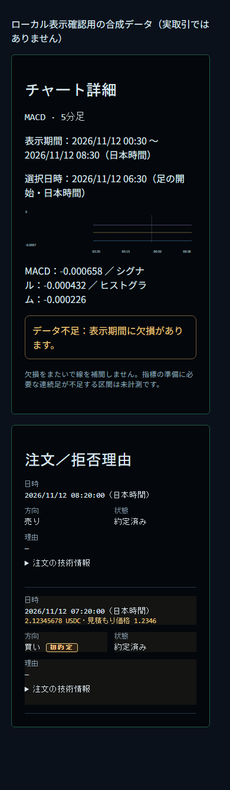
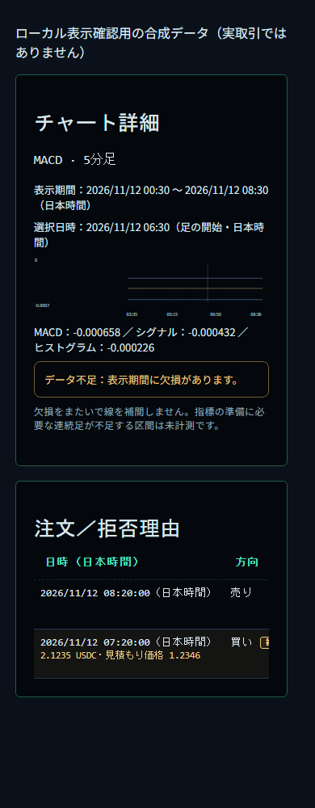
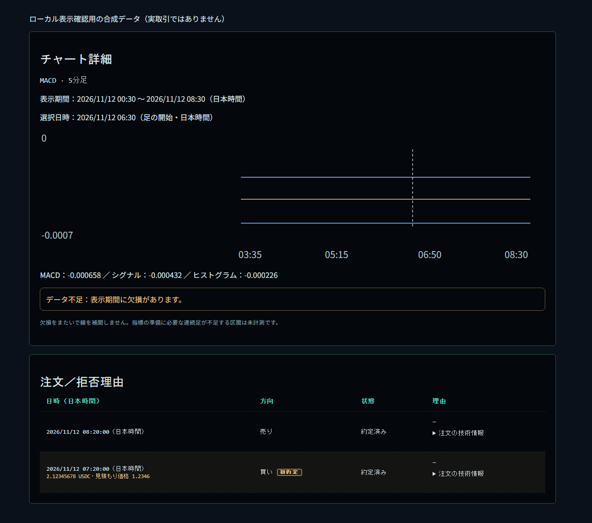
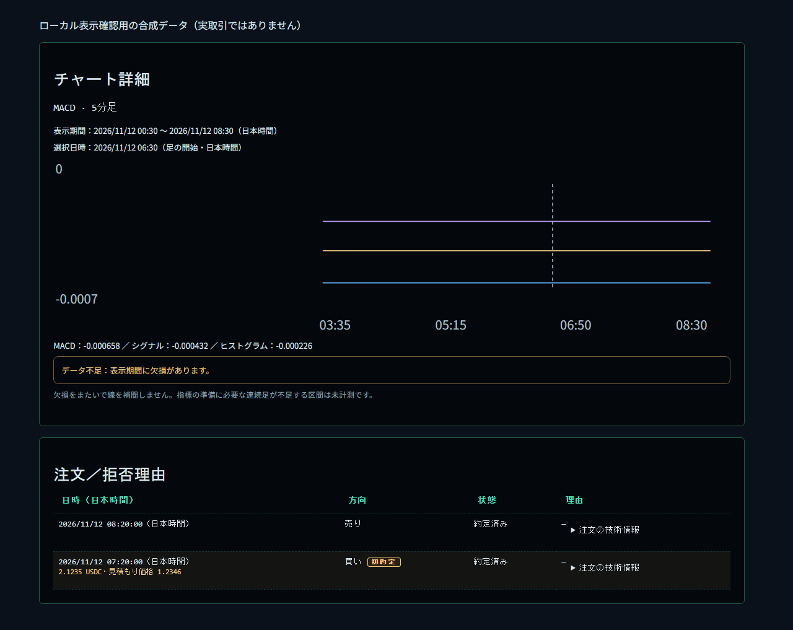

# 表示クリーンアップ検証（2026-11-12）

基点: `c65546e`（取得時点の最新 main）。Node 24.22.1 / pnpm 9.12.3。
本番、VPS、Windows Bot の起動・停止・設定・DB 更新は行っていない。

## 前 → 後

- チャート詳細の表示期間・選択日時・指標値・警告: 16px → 13px。本文の左端と余白を統一し、指標の「名前＋値」単位で折り返す。文言・数値・警告条件・欠損時の非補間は維持。
- 注文履歴: スマホの複数段カード → 日時／方向／状態／理由の表形式。狭い画面では表内を横スクロールできる。技術情報の開閉・JSON・初約定の補足を維持。金額・価格の補足は fixed4。
- 日時: JSON 内の timestamp のみ参照 → 表示専用の DB 読み出しで paper_orders.timestamp を返す。取引用の汎用 history() と保存内容は変更しない。

## 日時の調査

`engine.ts` の FILLED 注文 JSON は `{ id, side, status, quote, profitGuard }` で timestamp を含まない。
`BotDatabase.commitFill()` は同じ注文の SQL timestamp 列と paper_trades に `trade.timestamp`（epoch ミリ秒）を保存している。
従来の `history("paper_orders")` は `SELECT json` だけを返すため、保存済み SQL 時刻が API へ渡らず、OrderHistory の `o.timestamp` が undefined となって「未取得」になる。

修正層は DB の表示専用読み出しと API の対応づけ。`orderHistory()` を追加し、`/dashboard/records` と従来の snapshot 経路の両方で使用。ブラウザ側で時刻を推測したり、createdAt・現在時刻で埋めたりしない。timestamp のない props は引き続き「未取得」。SQL の保存済み時刻が JSON の異なる時刻より優先される。

**報告された実2件の照合は未完了。** この作業環境の元チェックアウト `data/bot.sqlite` は readOnly で参照したが注文0件だった。seq 23 の DB/export の保存先は確認できず、その2件が本当に時刻を欠いているとは断定していない。上記はコード経路とインメモリ DB の再現テストで特定した原因。実データの照合には対象 DB または export が必要。

## 検証

- 対象 Vitest（日時、初約定、dashboard feed、指標、CSS balance/palette）: 40 件成功。
- 全 Vitest（通常ローカル権限）: 136 ファイル成功 / 2 skip、1601 件成功 / 12 skip。
- sandbox 内の全 Vitest は loopback EACCES 等で 40 件失敗したが、通常ローカル権限で全成功。Windows 固有の未解消失敗はなし。
- typecheck: 成功。
- lint: 終了コード0、既存 exhaustive-deps 警告16件。
- build: 成功（既存の chunk size 警告）。
- render-smoke: 成功（Chromium、通常ローカル権限）。
- 回帰テスト: SQL 時刻 → 新旧 API → DashboardClient → OrderHistory の経路と fixed4、時刻なしの「未取得」を検証。

## ローカル3101の目視確認

本番 API を使わない、対象コンポーネントと実 CSS の合成データを `127.0.0.1:3101` で配信して Chromium で描画。スクリーンショットを目視し、390px/1280px で単語途中の折返し解消、13px、画面全体の横あふれなし、技術情報の開閉を確認した。注文表内の横スクロールは意図的。
390px の行高は 196px → 61px（44px の開閉操作領域は維持）。撮影後、確認用サーバーは終了。

| 幅 | 修正前 | 修正後 |
|---|---|---|
| 390px |  |  |
| 1280px |  |  |
